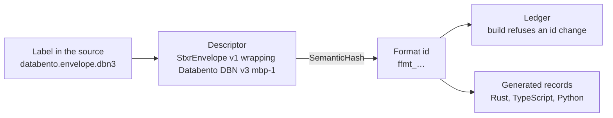

# SESS-00QGNFK: Catalog of canonical market data feeds: definitions, feed ids, codecs

## Goal stated by the user

- Bring three things together:
  - `data-feed-core` (the core types of a data feed),
  - `prototypes/data-feeds-code-generator` (earlier work on feed definitions),
  - `data-feed-definitions/rust/crates/data-feed-definitions` (handrolled feed
    codecs).
- Build a catalog of the market data feeds, similar to how market info is
  handled (`market-info/assets`).

## What is missing, per the user

- No canonical data feed id. The handrolled demo feeds have the idea of a
  data feed kind id and a data feed subject id; together they compose the
  data feed id.
- The shape of a feed should be declared once as a template. Every feed
  instance (template + subject) is then generated into a single binary file
  that the feed info server clients read and distribute.

## Example: Databento MBP1 feed

- Known subject structure: instrument id.
- Known shape: `Mbp1BookUpdate` and `Trade`.
- Known vendor, and a known meaning for each event that comes in.
- The user wants to remove the hardcoded `pub static DATABENTO_MBO_FEED` in
  `data-feed-definitions/rust/crates/data-feed-definitions/src/demo/databento_mbo_feed.rs`
  ("disgusting") and declare the definition with the core types instead.

## Open questions

First question the user wants answered: how do we declare the definition of a
canonical feed such as the Databento MBP1 feed?

It raises these:

1. Where is the shape defined?
2. How is it defined: Rust values or some kind of DSL?
3. How does code get at a definition, or does code always rely on the data
   feed info being passed in a config?
4. How is a feed definition linked to its codec?
5. How do we tell apart the shape of the data that comes in from the
   semantic trait or view applied to that data?

## Findings (2026-10-13 research, no user input yet)

- data-feed-core has the full content model (provider, subject, events,
  messages, fields with field semantics, envelope, cadence, encodings) and
  ids `feed_`/`frev_`/`cshape_`/`mshape_`/`ffield_` (BLAKE3) plus
  `fsubj_` (`FeedSubjectId`, first 16 bytes of the subject digest). No kind
  id, no codec or view traits, no catalog or loader. serde only; every
  `*Deser` requires and re-checks the computed ids (`field_id` included).
- Core `FeedId` = provider + subject + semantic content (event kinds, message
  semantics, aggregation, semantic_revision); excludes fields and encodings.
  Core `FeedRevisionId` = provider + subject + content shape + encodings, so
  it is per subject.
- data-feed-definitions demo layer (`src/demo.rs`) does not use core
  `DataFeedDefinition` at all: `FeedKindId` = first 16 bytes of BLAKE3 over a
  name seed (`"databento_mbo"`), `FeedId` = `kind || subject` (16+16 bytes),
  `FeedRevisionId` = hash of the seed only (not content). Topic
  `feeds.{fkind}.{fsubj}.{frev}.{encoding}`; kind wildcard
  `feeds.{fkind}.*.{frev}.{encoding}` only works because frev is subject
  free. ISS-0AQP5 (open) asks for exactly this split in the core.
- `DATABENTO_MBO_FEED` is MBP-1 (name is wrong). Wire: FlatBuffers
  `DbnMdUpdate { instrument_id: u64, payload: [ubyte] }` holding one raw DBN
  v3 record; codec `data-feed-codec-dbn-0c63c4bb...` routes on DBN `rtype`,
  MBP-1 records with action Trade go to `Trade`, others to `Mbp1BookUpdate`.
  Orderand `DatabentoOrderand(u32)` = DBN `sequence`.
- View traits `Mbp1BookUpdate` and `Trade` are handwritten and provider
  neutral (`demo/traits.rs`); the per-feed traits add
  `HasFeedOrderand<Orderand = DatabentoOrderand>`.
- Codec crates are named by the kind id hex today, except DBN; DEC-0APF7 says
  one codec crate per ContentShapeId x EncodingKind. Service codecs already
  assert their crate name from a digest (`tests/crate_name.rs`).
- Consumers read compiled-in statics; only notify-gw takes `fkind_` from
  config (checked against the static). Kind ids are hardcoded in infra
  (event-bus.ts, monitoring.ts), the realtime-gateway TS dashboard
  (reimplements composition), and client-core. No feed-info checkout exists;
  the feed-info-server in infra is disabled.
- Prototype: YAML with three layers (provider wire `input_definitions`,
  normalized `content_definitions`, handwritten semantic view traits checked
  by the generator); codecs keyed by MessageShapeId/ContentShapeId; decoder
  lookup by (FeedRevisionId, encoding). Lost information on the way: provider
  `databento` became `Other`, field semantics inferred from names.
- market-info pattern: one RON file per record under `assets/`, decoded
  through constructors that recompute ids; ids in files are optional
  annotations checked by the build; ledgers + `market-info.rkyv` with a
  magic + schema-hash header.
- Core gaps hit by the DBN MBP-1 record: field id is derived from the field
  semantic, so `bid_px_00` and `ask_px_00` both tagged `Price` collide
  (`DuplicateDefinition`); scalar types have no widths (u8/u16/u32/i32/char)
  and no fixed-point scale (DBN prices are i64 x 1e-9); no way to say "one
  wire message, event chosen by the `action` field value"; no subject kind
  (only concrete `DataFeedSubject` values).

## Agent proposal (not decided)

1. Feed kind = template: provider + subject kind + content + encodings. One
   RON file per feed kind in data-feed-definitions (`assets/feed-kinds/...`),
   decoded into core types; computed ids optional annotations, like
   market-info. Rejected by the agent: Rust values (LazyLock statics again,
   unreadable from TS/catalog builder), a new DSL/YAML grammar (prototype lost
   information mapping into core types).
2. `FeedKindId` moves into data-feed-core, computed from provider + subject
   kind + semantic content (ISS-0AQP5), not a name seed. `FeedId` =
   `kind || subject`. `FeedRevisionId` computed per kind (kind + content
   shape + encodings), without the subject.
3. Wire shape = fields in the definition, hashed into ContentShapeId; codec
   crate named `data-feed-codec-{encoding}-{cshape}` and asserts it. Meaning
   = event kinds + message semantics + field semantics, hashed into the kind
   id. View trait = handwritten provider-neutral Rust/TS trait, one per message
   semantics; adapters wire -> view live in the codec crate.
4. Code compiles against generated constants of the kinds it decodes (kind
   id, revision id, content shape id); which subjects exist comes from the
   catalog binary (kinds x market-info instruments) or config at runtime.

## Round 2: wire shape vs domain shape (user, 2026-10-13)

- The user agrees with the split between wire shape, meaning and the
  domain shape: "What for us is a trade, can be laid out very differently for
  different providers." Wire shape and domain shape sometimes match,
  sometimes not.
- Concern: canonical feed declarations are needed in Rust and TypeScript,
  maybe Python.
- Every wire format has its own type names; the user has "no desire to mimic
  that". Idea: declare the received layout as byte size + interpretation.
  Easy for numbers and booleans, painful for strings, bytes, collections.
- The user's framing: a wire layout per encoding, and the domain event
  layout in our domain types (InstrumentId, AssetId, TradingAccountId,
  Arc<str>).

### Agent proposal 2 (not decided)

- One source, generated per language (Rust, TS, Python); nobody declares in
  three languages. Runtime reads generated code or the catalog binary, never
  the source. Agent now leans to extending the protocol DSL of
  `prototypes/market-info-protocol` over RON, because layouts and mappings are
  awkward as serde values of core types.
- Three declarations:
  1. Domain event (`event Trade { instrument_id: InstrumentId, ... }`) in
     our domain types; one per meaning, provider neutral. View interfaces
     generated per language; the domain types themselves stay handwritten
     (DEC-0C0TX) and declare their primitive representation.
  2. Wire layout in our own closed vocabulary (u8..u64, i8..i64, f64, bool,
     char, bytes[N], bytes, string, list) + interpretation (scale, time unit,
     null sentinel, enum value table, const). Two families:
     fixed-offset formats (DBN, SBE, C structs) are fully described by offset
     + size; variable data is either fixed capacity (DBN `c_char[71]`) or the
     SBE way (repeating group = count + fixed entry; var data with a length
     prefix at the tail). Tagged formats (protobuf, FlatBuffers tables, JSON,
     msgpack) cannot be described by offsets: we declare fields with
     representations and the generator writes `.proto`/`.fbs`; encoding type
     names are output only.
  3. Mapping wire -> domain with a closed set of conversions (newtype from
     same representation, scale, time unit, enum table, null -> none or
     reject, const check, `when` discriminator such as DBN `action == 'T'`);
     anything else is a named function handwritten per language.
- For feeds we produce, the wire layout defaults to the domain event under an
  encoding (they match); explicit layouts only where the provider owns the
  bytes or a fixed layout is wanted.
- Consequence for data-feed-core: `DataFeedFieldDefinition` mixes wire
  scalars, domain-ish scalars (Decimal, Timestamp) and meaning tags; with
  meaning carried by the domain event field, field semantic tags and the
  bid/ask `Price` id collision go away. Kind id hashes the domain events;
  content shape id hashes the wire layout; the mapping belongs in the
  revision.
- DBN MBP-1 with ts_out = 88 bytes (80 + `ts_out` u64 at 80); DBN trade
  side `B` = buy aggressor, `A` = sell aggressor, `N` = unknown.

## Round 3: where the logic lives (user, 2026-10-13)

- Example: incoming JSON has no rule for u64; some providers send a number,
  some a string. The domain only cares about an integer u64, so the
  adapt/transformation layer must say "string to u64". Serde does this with
  attributes, but "there is a limit to how far a declarative approach will
  lead you".
- User's idea: describe all logic and the adapt layer in Rust; for other
  languages generate only the domain types, with a bridge between the Rust
  "engine" and that language's domain logic. "Game engine vibes."

### Facts checked

- The pattern exists twice already: `client/crates/client-core` is a Rust
  sans-I/O engine compiled to WASM (depends on the DBN codec crate; README:
  events in, actions out as JSON; live and HTTP bytes cross as
  `Uint8Array`), and `application-server-core` runs as WASM in the TS
  application server.
- JSON across that bridge has the same u64 ambiguity the user wants to avoid.

### Agent proposal 3 (not decided)

- Two kinds of logic, both Rust code: representation (how the bytes write a
  value: u64 as JSON string, endianness) belongs to the wire codec;
  interpretation (scale, null to none, Bid to Buy, picking the event by
  `action`) belongs to the adapter. The round 2 mapping language is dropped.
- Vendor wire formats are handwritten Rust (serde structs, the dbn crate);
  a declarative wire layout is optional for them.
- What crosses the bridge decides everything: domain events as bytes in one
  canonical layout we own, generated per domain event, read in TS/Python by
  generated readers over the bytes (no per-field FFI calls, batches). Agent
  suggests FlatBuffers for it (strings and lists already solved, official
  Rust/TS/Python libraries, already used for DbnMdUpdate and the market info
  protocol) over inventing a variable-length layout.
- The same Rust engine can run in-process (WASM for TS, PyO3 or wasmtime for
  Python) or out-of-process as a normalizer service publishing canonical
  feeds. Raw vendor feed and normalized feed are two representations of the
  same feed (same kind id, different content shape), matching REF:data-feed.
- Declarative part left: domain events (-> domain types per language +
  canonical layout), feed kinds (provider, subject kind, events, wire,
  adapter). Generated Rust trait bounds make an adapter that does not
  produce the declared events fail to compile.

## Round 4: user restates the concept (2026-10-13)

User's restatement, with the user's own correction applied: the feed
definition holds a REFERENCE to the codec + adapter (the code is not part of
the definition). "We abandon the idea of having a declarative way to describe
all the transformations and wire formats, instead we embrace code, but for the
domain types, we can perfectly rely on code generation since we own every part
of it. As long as we use our own \"engine\" as the entrypoint of every program,
the consumer doesn't have to care about the decoding/encoding part." The Rust
codec is treated as logic, with "some type-checking layer in between". The
user also said different wire formats -> different codecs -> different
semantic feed kinds.

Agent answer: concept right, with three refinements (not decided):
- Kind = provider + subject kind + domain events; a codec is a
  representation of the kind (revision + encoding), not the kind. A
  different provider is already a different kind; the same provider sending
  the same events in another encoding stays the same kind so consumers
  subscribe by meaning. Codec = kind only if the user prefers simplicity.
- The type-checking layer has three parts: generated domain traits/types,
  the generated bound that the referenced adapter produces exactly the
  declared events (compile time), and the content shape id in the topic so
  the engine refuses bytes made for another shape (runtime). Adapter logic is
  not covered by any digest; golden fixtures (recorded raw bytes -> expected
  domain events) cover it.
- The engine is a sans-I/O library, the entry point for decoding only, not
  the program's main loop; the host owns I/O. Consumers of canonical feeds
  need only generated readers, no engine.

## Round 5: codec revisions and choosing an encoding (user, 2026-10-13)

- On the adapter-logic gap: that is why the user wanted revisions of adapters
  and codecs. A breaking Databento release ("v42069") is a different message
  shape from the previous one. The place the feed comes from can also be very
  different.
- If codecs and adapters handle many versions and encodings, which one is
  chosen? "We don't want to hide that from the user, we just want to simplify
  the menial work of handling it all."

### Agent proposal 5 (not decided)

- Three levels: feed kind (meaning: provider, subject kind, domain events) ->
  representations (framing + payload format and version + encoding + codec
  revision; one revision id each) -> sources (where a representation can be
  read: NATS subject pattern, GCS path pattern, vendor API; live or
  historical; time range). A vendor layout change adds a representation; a
  vendor change that alters our domain events is a new kind.
- Example: databento.mbp1 has r1 = DbnMdUpdate (FlatBuffers) + DBN v3 MBP-1,
  live on NATS; r2 = Databento file (zstd DBN) + DBN v3, historical in the
  bucket; a future v4 adds r3 while v3 files already downloaded stay r2.
- A single `EncodingKind` cannot name a layered representation: today the
  topic says `flatbuffers` but the payload is DBN inside FlatBuffers.
- Codec revision: explicit number, never a digest of code. A released revision
  is immutable (same rule as sim-gw snapshots: never edit v1, add a version);
  each revision keeps its golden fixtures (raw bytes -> expected domain
  events) forever. Representations get a status like market-info listings
  (current, deprecated, retired), never deleted.
- Choice is explicit and recorded: deployment/backtest config pins kind +
  revision + encoding (the `DataFeedRef`, as ISS-09HW2 asks). "latest" is
  allowed as input but resolved once at creation and stored, like the
  strategy runtime revision in SESS-00PE96K. The program links the codec
  crates it accepts (Cargo deps = the visible list); a generated dispatch
  table (revision, encoding) -> decoder does the routing; bytes for an
  unlinked revision are refused with an error naming the missing codec.

## Round 6: revisions, sources, choosing a feed (user, 2026-10-13)

- Asked whether a codec revision is a git commit.
- Golden fixtures per revision forever: yes.
- "I don't think DataFeedRef is a good abstraction anymore, I think we need to
  rethink that. We're changing the data feed definition record."
- Generated dispatch table (revision, encoding) -> decoder: yes.
- Catalog of representations and sources: "probably". Not sure sources should
  be attached directly to data feeds, but likes the Databento example
  (consume from our market data server's FlatBuffers envelope, `.dbn.zst`
  files, etc.).
- Our own semantic events sent inside our infrastructure can use the same
  FlatBuffers encoding as the bridge, since we own all types and infra.
- Open for the user: how codecs and adapters are named and referenced; what
  drives their unique reference.
- Pinning in deployment/backtest config with latest resolved once: "tricky".
  Start with services where the data origin is known, e.g. notify-gw: a
  protobuf Alert and a JSON Google incident. Question: is the feed choice
  driven by the domain event wanted or by the source the data comes from?

### Facts checked

- notify-gw config (`monitoring/rust/crates/notify-gw/src/config.rs`): one
  `FeedConfig` per subscription: `kind: FeedKindId`, `encoding`, `source`
  (`pubsub { subscription }` or `nats { subject }`), `payload_bytes_max`.
  `config/feeds.rs` `resolve_feed(kind, encoding)` maps (alerts kind,
  protobuf) and (incidents kind, json) to an internal `FeedKind`, otherwise
  `None`. Google incidents carry no attributes, so the config is the only
  statement of what arrives there.

### Agent answer 6 (not decided)

- Revision number for identity, git commit for provenance. A commit names the
  whole repo state (unrelated changes give new commits), has no order, and
  Cargo links one commit of a repo, while a program reading v3 history and v4
  live needs two revisions in one build. Proposed: each released revision is
  its own module (`rev1`, `rev2`) never edited after release, with its
  fixtures; the catalog records the commit it was built from.
- Codec and adapter have different identities. A codec reads one
  representation (framing + payload format + version + encoding) into wire
  messages; its identity is that representation, e.g. `databento-dbn-v3`.
  An adapter turns a codec's wire messages into the domain events of one
  kind; its identity is (codec, kind), e.g. `databento-mbp1` over
  `databento-dbn-v3`. Today's DBN crate already has one codec with three
  adapters (MBP-1, status, OHLCV). Handwritten code gets human names +
  revision numbers; digest names stay for generated code (the domain
  FlatBuffers), whose content a digest fully determines.
- Sources point at representations, not the other way: a source (our NATS
  subjects, a bucket path pattern, a Pub/Sub subscription) states which kind
  and representation it serves; feed definitions stay free of infra.
- What drives the choice in notify-gw: the domain events drive the code
  (handlers for Alert and Incident, compile time); the operator picks
  sources (config); the representation is a fact about the source, never
  chosen separately. Config names each source and what it serves; startup
  refuses a representation with no linked codec (today's `resolve_feed`);
  runtime checks message attributes when the source has them. Matches
  "one feed + encoding per subscription".
- Under D5 the alerts feed becomes the domain FlatBuffers representation;
  Google incidents stay a vendor JSON codec + adapter producing a domain
  Incident.

## Round 7: template and instance naming (user, 2026-10-13)

- The feed definition is unclear too. A feed definition template explains the
  shape of the feed's domain events, its codecs, subject kind and metadata
  such as the vendor. Then there are the instances of that feed, one per
  subject.
- "I don't think we need a single 'feed id' that combines both, let's get
  away from that idea."
- Model: like Avro in the application database: the schema is stored once,
  each row stores its own data and points to the schema id.
- Asked how to name template and instance.

### Facts checked

- Application database (DEC-0C6J2): `avro_schemas(fingerprint bytea PK,
  full_name, schema, create_time)`, append-only (triggers reject update,
  delete, truncate); every blob is an Avro single object carrying its writer
  schema fingerprint.

### Agent proposal 7 (not decided)

- Avro analogy with one shift: an Avro schema is meaning and layout together;
  here meaning is the kind, layout is the format. Each message carries the
  format it was written with, as an Avro single object carries its
  fingerprint; formats are append-only like `avro_schemas`.
- Names:
  - `FeedKind` (template): provider, subject kind, event types, formats;
    `FeedKindId` `fkind_`; human name such as `databento.mbp1`. Kept over
    "template" (suggests text substitution) and "schema" (suggests layout);
    `fkind_` is already deployed (infra, notify-gw config, Pub/Sub attrs).
  - `Feed` (instance): a kind for one subject, identified by the pair
    (`FeedKindId`, `FeedSubjectId`), no id of its own.
  - `FeedSubject` / `FeedSubjectId` `fsubj_` (exists); `SubjectKind` closed
    enum (instrument, trading account, strategy deployment, ...).
  - `EventType` / `EventTypeId`: a domain event declared once and shared
    across kinds (`Trade` for Databento and Coinbase); generated code named
    by its digest.
  - `FeedFormat` / `FeedFormatId` `ffmt_` (replaces "representation" and
    `FeedRevisionId`): one way a kind's events arrive as bytes = codec ref +
    adapter ref; content hash of kind id + codec ref + adapter ref.
  - `Codec` `name@revision` (bytes -> wire messages), `Adapter`
    `name@revision` (wire messages -> event types of one kind).
  - `FeedSource`: where a format of a kind can be read (subject pattern,
    bucket path, subscription).
  - `FeedRef { kind, subject, format }` replaces `DataFeedRef`; topic
    `feeds.{fkind}.{fsubj}.{ffmt}`.
  - Removed: `FeedId`, `FeedRevisionId`, `FeedRevisionSequence`,
    `DataFeedRef`, `EncodingKind` as a separate choice (inside the codec);
    `MessageShapeId`/`ContentShapeId` superseded by `EventTypeId`.
  - Drop the `Data` prefix in type names (`FeedKind`, not
    `DataFeedKind`); crate names keep `data-feed-*`.

## Round 8: why the current implementation has a revision (user question)

Agent answer (facts): in data-feed-core (DEC-0007, REF:data-feed) the
revision exists so the semantic `FeedId` survives layout and encoding changes;
`FeedRevisionId` names the exact layout (content shape) + supported encodings,
decoders are chosen by (revision, encoding), `FeedRevisionSequence` orders
revisions so the highest is current. That role is what `FeedFormat` now takes.
In the demo layer every revision id is `demo_digest(revision algorithm, seed)`
with the same seed as the kind, so each kind has exactly one revision that
never changes with content; it carries no information beyond the kind and is
kept only to fill the core's slot in `DataFeedRef` and the topic. Bumping it
would need a new seed, which also changes the kind id.

## Round 9: adding fields to a semantic event (user question)

Agent answer (proposal, not decided):
- Problem with round 7: if the kind id hashes the full event declaration,
  adding one optional field makes a new kind and moves every instance, topic
  and subscription.
- Event type = stable name (`Trade`) + revision, like an Avro `full_name` with
  fingerprints per version. Kind id hashes provider + subject kind + event
  type names, not their layouts.
- Compatible change = append an optional field: new event type revision,
  same kind. FlatBuffers allows appending table fields: old readers ignore
  them, new readers see them absent in old data (history included). The
  generator keeps explicit field ids and refuses reorder, removal, type change
  or a new required field against the previous revision (build check like
  market-info's id ledger).
- Rust: the new view trait method has a default returning `None`, so released
  adapter revisions compile unchanged (D3 immutability holds) and report the
  field absent; a new adapter revision that fills it is a new format.
- A consumer that needs the new field must read a format whose adapter fills
  it; adapters could declare the optional fields they provide, checked by
  their golden fixtures.
- Incompatible change (remove, retype, change meaning, new required field) =
  new event type = new kind, explicitly.

## Round 10: the list of concepts (user question)

User asked: "so, there is a feed kind, feed revision, feed subject, feed
format?" Agent answer: no feed revision. Nouns: FeedKind (template, no
revision; append-only list of formats), FeedSubject, Feed (instance = kind +
subject), FeedFormat (codec@rev + adapter@rev). Revisions live only on
EventType, Codec and Adapter. The old revision's job (which layout are these
bytes in) is the format; its ordering job (latest wins) goes away because
formats coexist (v3 history and v4 live are both valid); which format is
current is a property of a source, not of the kind.

## Round 11: walk-through of adding an optional field to Trade (user question)

Agent correction to rounds 7 and 10: the format id must describe the bytes
only, so `FeedFormat` = `codec@rev`, not codec + adapter. The bytes on the
wire do not change when a consumer upgrades its adapter, and a producer
(vendor or our republisher) cannot know which adapter a consumer runs.
Adapters are consumer-side code: the kind lists which adapters exist per
format, the program links the ones it uses, the dispatch table maps format ->
(codec, linked adapter), and backtests/deployments record the adapter
revisions they ran (their output depends on it). Same issue for our own
feeds: if the generated domain FlatBuffers codec changed id on every
compatible event type revision, old consumers would refuse compatible bytes;
so that format is identified by the event type names + compatibility line,
not by revision.

Walk-through (agent, not decided), adding `trade_id: optional TradeId` to
`Trade`:
1. `Trade` rev 1 -> rev 2; generator checks the field is appended and optional.
2. Generated: Rust trait method `fn trade_id(&self) -> Option<TradeId> { None }`,
   `.fbs` field appended with the next explicit id, TS/Python readers gain it.
3. Unchanged: kind ids, feeds, subjects, topics, subscriptions, every format
   (vendor bytes did not change; domain FlatBuffers stays compatible).
4. Existing adapter revisions compile unchanged and return `None`; their
   fixtures still pass.
5. Coinbase sends a trade id: write `coinbase-matches@2` filling it, with new
   fixtures; consumers get the field once they link it. DBN has no trade id,
   so Databento adapters never fill it and it stays `None` for that kind.
6. Old consumers reading new domain FlatBuffers ignore the field; new
   consumers reading old messages and history see it absent.

## Third-opinion review requested by the user

The user asked Codex to join the existing agents as a third opinion. Codex joined
this record and reviewed core identity/content, the generator prototype, the
handrolled DBN codec, the living data-feed reference, the accepted repository
layout, and the market-info catalog compiler pattern.

The review is in
`../../.dev-env/data/sessions/sess-00qgnfk/notebooks/feed-catalog-third-opinion.md`.
It contains recommendations and explicit open questions, not user decisions.
Key evidence for the other agents: the demo uses one MBP-1 physical record and
dispatches by action; core digest feed IDs and demo concatenated kind/subject
IDs are currently different schemes. No implementation or knowledge-base edits
were made by this review.

Main recommendation (Codex, not decided): add a subject-independent
`FeedTemplate` to data-feed-core as the canonical declaration. Templates are
authored as data in data-feed-definitions; a host compiler validates them with
the core constructors, generates codec metadata and expands the supported
subjects into one catalog archive. "I would start with RON authoring inputs"
because market-info already works that way; Rust vs a text format is
secondary to the intermediate model. Codex's own sub-agent disagreed and
recommended Rust constructors first (the second opinion below takes that
side). Later rounds went elsewhere: D18 (Rust macros), then round 27b
(SQLite + Avro change log).

Other points from the review:
- Keep five identities apart: kind (provider + semantic product, no
  instrument), feed (kind bound to one subject), definition revision,
  representation/codec contract (framing, wire schema, encoding, semantic
  binding), catalog release (the published snapshot, with its own format
  version and digest).
- Core's `MessageShapeId` already includes semantics and aggregation, so it
  is not a pure wire layout hash; use it deliberately (relevant to rounds
  21-22). The prototype's protobuf field numbers can change without changing
  its shape or revision ids.
- A physical view says which fields exist; a semantic view says what they
  mean (units, event time, update behaviour). The binding between them stays
  reviewed Rust.
- Unknown contracts must fail at subscription setup, before any payload.
- Open in the review, never answered by the user: unknown/control actions
  and end-of-event flags, how the semantic binding is versioned, distinct
  vendor products with equal semantics, where the binary reader sits, and
  the trade vs book question below. Its coverage recommendation was rejected
  by D19.

## Second-opinion review (Claude, second session)

Claude joined this record as the second opinion and reviewed data-feed-core
(identity, subject, content, schema), the demo feeds and the handrolled DBN
codec, the code generator prototype, the knowledge-base records (DEC-0007,
DEC-0APF7, DEC-0008, DEC-0009, DEC-0C0TX, DEC-0CAF0, ISS-0AQP5, ISS-0BJR2) and
the market-info catalog pipeline, and read the third opinion.

The review is in
`../../.dev-env/data/sessions/sess-00qgnfk/notebooks/feed-catalog-second-opinion.md`.
Recommendations, not user decisions. No code or knowledge-base edits.

Where it agrees with the third opinion:

- A subject-independent kind (template) belongs in core, with
  `FeedId = kind id || subject id` composed and split by core, replacing
  core's current provider+subject+content digest. Matches ISS-0AQP5.
- MBP-1 is one wire record; `Mbp1BookUpdate` and `Trade` are two semantic
  contracts satisfied by it, dispatched on the DBN action field.
- Instances are expanded from a coverage declaration on the kind against a
  pinned market-info revision, not from every instrument in market-info.
  (Rejected later by the user, D19; the feed list became a script, round
  27b.)
- First step: declare the MBP-1 kind with core types, instantiate for two real
  instruments, build the archive, keep the handrolled DBN reader.

Where it differs:

- Authoring format: Rust values in one crate per kind (ISS-0BJR2), built with
  the core constructors, not RON. A kind binds to Rust types (closed event
  enum, contract trait impls, codec type per encoding) that a file cannot name
  or check; core constructors already validate and derive the ids; there are
  about fifteen kinds, each with code; the archive is serde/rkyv output either
  way, so readers see data regardless.
- The kind id should also hash the subject kind, so per-instrument and
  per-instrument-set feeds are different kinds. Revision id belongs to the
  kind (kind id + content shape id + encodings), which the wildcard topic
  already assumes.
- Codec link is type level (`FeedCodec<Encoding> for Kind` naming the
  consumer type) and recorded in the archive as data. Two naming rules for
  codec crates: generated from our content, named by content shape id;
  handrolled for a vendor format, named by kind id. The DBN crate hash
  matches nothing today and the README rule is false for the feed codecs.
- Delete the seeds and the per-file hex pins in the same step as the kind id
  change, since every topic, Pub/Sub filter and dashboard constant changes
  anyway; replace them with a checked-in ledger the catalog build diffs.

Facts for the other agents, verified in code:

- Core feed id hashes content semantics only (event kinds, message semantics,
  cadence); revision id adds the content shape id and encodings. So core
  already has the semantic/shape split the kind id needs.
- Demo revision ids hash only the seed string, so a shape change never
  changes the revision.
- Feed codec crates are named by kind id, not content shape id; nothing tests
  those names; `data-feed-codec-dbn-0c63c4bb…` matches no id.
- No feed info server runs; every service compiles the statics in. Config
  carries kind ids only in notify-gw, validated against the statics.

Questions left for the user (also at the end of the notebook), with what
became of them:
- Does a trade record also emit a book update, or stay exclusive? Never
  answered. The reviewer leaned to "both" and warned it changes behaviour for
  every consumer.
- Subject kind in the kind id? Not decided (D13 lists the subject kind as
  part of the kind template).
- OHLCV as four kinds or one? Settled by the build: one kind per provider
  and interval (round 27b).
- Who assigns the revision sequence? Dropped in round 10.
- Archive read directly by services, by the feed info server, or both? Not
  answered; round 27b says a feed info server manages the feeds.

Archive layout proposed by the review (not adopted): `data-feeds.rkyv` with a
header, a `feed-kinds.csv` ledger the build diffs, and the pinned
market-info revision.

## Round 12: wire changes and new wire messages (user question)

User asked whether the Q&A is kept in the session so it can be written into
decision documents. Agent: yes; rounds hold the user's words, facts checked and
agent proposals marked not decided; only the Decisions list is decided.
Rounds 5, 7, 9, 11 and 12 proposals are unconfirmed. Agent moved the two
review sections above the Decisions list so D1-D6 read together (content
unchanged). Note: D6 rejects the reviews' `FeedId = kind id || subject id`;
D4's "(revision, encoding)" reads as "format" after round 11.

Walk-through (agent, not decided):

A. The wire changes (Databento ships DBN v4):
1. New codec `databento-dbn-v4@1` beside v3 (v3 untouched), golden fixtures
   from recorded v4 bytes.
2. New format (`ffmt_` of that codec) appended to `databento.mbp1`; kind,
   event types, feeds, subjects unchanged.
3. New adapter for (v4 codec, kind) with its own fixtures; may share code with
   the v3 adapter, released revisions stay untouched.
4. Rollout: consumers first (link v4 codec + adapter, dispatch handles both
   formats), then the market data server publishes v4 with the new format id.
   A consumer without v4 refuses those messages with an error naming the
   missing codec. Consumers subscribe by kind + subject, not by format.
5. Sources: the live subject serves v4 from the switch time; the bucket holds
   v3 before and v4 after; a backtest across the boundary links both and
   records the formats and adapter revisions it read.
6. Handler code unchanged. New information in v4 -> round 11 flow (append an
   optional field). If v4 drops something an event requires, the adapter
   cannot satisfy the trait -> new event type -> new kind.

B. A new wire message for the same domain event:
- B1, same stream gains a message type (e.g. Trade also from MBO or DBN
  trade records on the same subject): codec must decode it -> new codec
  revision -> new format, so old consumers refuse instead of silently
  skipping unknown records; new adapter revision maps it to `Trade`; kind
  unchanged because `Trade` is already among its events; same rollout order.
- B2, a separate stream or provider (Databento `trades` schema, Coinbase): new
  kind (different provider or different event set); handler code reused as is
  because `Trade` is the same trait. This is the payoff of shared event types.
- Surfaced: with the kind id = provider + subject kind + event type names,
  Databento MBP-1 and TBBO both give {Mbp1BookUpdate, Trade} and collide,
  though one is every top-of-book change and the other is sampled at each
  trade. The kind id needs the cadence (as core has today) or the kind's
  name; feeds into the open "kind id from content or name" question.

## Round 13: push only, or request/reply too? (user question)

Facts: DEC-0C0TX (proposed) makes a protocol a separate entity: "a feed
requires a provider, a subject, and a feed identity, which mean nothing for a
protocol between two participants"; protocol messages reuse data feed content
shapes, one codec crate per side and encoding. DEC-0BTXY (proposed): service
payloads are not feeds, "they have no provider, subject or revision". Today
the Execute services group their shapes in data-feed-definitions
(`protocol.rs`, `content-shape-codec-protobuf-*`). DEC-0C0TX argues for Rust
definitions because content definitions are Rust values.

Agent answer (not decided): a feed describes events about a subject, however
they are delivered; push or pull is a property of a source. A request that
returns the feed's own events (bucket files, an event-gw list/tail of fills,
a replay) is a pull source of the feed. A request whose reply is an answer for
one participant (list market info, wallet challenge, start a backtest) is a
protocol, not a feed. Test: "something happened to a subject that anyone may
observe" -> feed; "an answer to this caller's question" -> protocol. Both share
the machinery (declared domain types generated per language, FlatBuffers
bridge, handwritten codec + adapter, golden fixtures). If declarations move
out of Rust values, DEC-0C0TX's reasoning for Rust definitions needs
amending; the market-info-protocol prototype already uses a DSL.

## Round 14: long poll vs list for logs (user question)

User: "so, if I long poll for logs, that's data feed, but if I want to list the
logs ASAP, then it's a protocol?"

Agent answer (corrects round 13's table, not decided): neither is decided by
latency or push vs pull. There are two layers in both cases: the exchange
(request with filter, page size, cursor; reply; errors) is a protocol, and the
items in the reply are the logs feed's events. ListLogs and PollLogs
(SESS-00P9RZK: list by event_time, tail by orderand, list returns the
tail cursor) are two operations of one event-gw query protocol, and both are
sources of the same logs feed. A protocol is "not a feed" only when its reply
items are not any feed's events (wallet challenge, start a backtest). Catalog
consequence: a `FeedSource` can be a protocol operation (e.g. event-gw
`PollLogs`), naming the kind and the format its items are in; under D5 the
items would be the domain FlatBuffers nested in the reply.

## Round 15: end to end, persisting Databento live data (user question)

User asked for an e2e summary for a service that persists market data from the
Databento live connection: which feeds are defined, how codecs and adapters
work; is Databento's incoming data a feed, or only what leaves our market data
server, or two feeds that compose; does the server declare the `.dbn.zst`
storage as a feed; does a backtest declare a feed to read the files.

Agent answer (summary of rounds 1-14, proposals not decided):
- One feed kind `databento.mbp1` (Databento, Instrument, {Mbp1BookUpdate,
  Trade}, event driven). Databento's stream, our NATS republish and the files
  are the same events: different formats and sources of one kind, not
  composed feeds.
- Codecs (handwritten, revisioned), one format each: Databento live session
  stream (DBN v3 with ts_out, many instruments, Databento ids);
  `DbnMdUpdate` envelope (our InstrumentId + one record); zstd DBN file written
  from live (records with ts_out); zstd DBN file from the historical API (no
  ts_out, 80-byte MBP-1) -> different layout, different format.
- Adapters per (codec, kind), thin over one shared DBN MBP-1 record view:
  action T -> Trade, else Mbp1BookUpdate; orderand = sequence. The live-stream
  adapter needs the Databento id -> InstrumentId map (ContractTable); the
  envelope carries our id; files get the subject from the path.
- Sources: Databento live API (push, many subjects, read only by the market
  data server); NATS `feeds.{fkind}.{fsubj}.{ffmt}` (push, per subject);
  live-capture bucket path (pull, per subject per day); historical bucket path
  `databento/GLBX.MDP3/mbp-1/{inst}/{day}.dbn.zst` (pull).
- Relays change format and source, never the feed, and work at codec level
  without adapters: the market data server (live stream -> envelope), the
  persister (envelope -> daily files). A service that computes new events
  (bars from trades, mid prices, consolidated book) produces a new kind with
  us as provider: that is where feeds compose.
- The persister declares a new source (its bucket path, its file format) of
  the existing kind, not a new feed. Suggested input: our NATS subject, so
  there is one Databento connection and the files hold what live consumers
  saw; cost: gaps while the server is down. Separate path from the download
  job's files.
- A backtest declares no feed: code says the event types it handles; config
  names kind + subjects + time range + source; the format follows from the
  source; it links that codec + adapter and records kind, subjects, source,
  formats and adapter revisions with its results. Replay keys become
  (kind, subject) instead of FeedId (D6).

## Round 16: notebook, decoders in on_feed_msg, answers (user, 2026-10-13)

- User asked for the round 15 report as a dev-env notebook with Mermaid, no
  ASCII diagrams ("If you're lacking the tools, tell me and we'll integrate
  something"; Mermaid is supported). Written as
  `.dev-env/data/sessions/sess-00qgnfk/notebooks/feed-catalog-e2e.md`.
- User liked "the pieces line up like this" (code says event types, config
  names kind + subjects + time range + source, format follows from the
  source, results record what was read).
- Asked how the component handling `on_feed_msg` gets the decoders, and
  whether they are generated.
- Answers to round 15's open questions: cadence in the kind (D7); sources
  (D8); persister reads our live data (D9); codec revisions are numbers (D10).

Facts: today the strategy template hand-writes it all
(`structure-strat-template-core/src/feed.rs`): `FeedCodecKind` enum
(DatabentoMbo, DatabentoStatus, DatabentoOhlcv, SimVenue), `FeedCodecs` holding
each codec consumer + adapter, `FeedRoutes` mapping a subject string to
(feed ref, codec kind), and `consume` matching on the codec kind. The target
executor (`DemoFeedMatcher`) and client-core (`FeedRoute::of`) each have their
own handwritten table.

Agent answer (not decided): generated. Each kind's crate gets generated
constants (kind id, format ids) and handler traits from the declarations; the
codec and adapter bodies stay handwritten. Each program lists the
(format, adapter) pairs it accepts in one macro invocation, the visible list;
the macro generates a struct holding codec scratch state and adapters, a
`consume(feed_ref, bytes, handler)` that matches on format id (static
dispatch, no `dyn`), the handler bound as the union of the kinds' handler
traits, and one error enum. The host gets the `FeedRef` from the topic or
Pub/Sub attributes (formal) or the file source table. An unlisted format is an
error naming it. Rejected by the agent: build.rs discovering codecs from Cargo
dependencies (hides the list).

## Round 17: generated traits, dispatch, the live API relay (user, 2026-10-13)

- User: is a trait for the domain event generated? "I see no reason to not do
  that." -> D11.
- Dispatch: "you just declare which ones you know how to handle and if we get
  data from somewhere we don't know, well, tough luck. Okay, I think it's fine
  for now." -> D12.
- Databento live API: the user does not want to transform the record to send
  it over the wire; take it raw, resolve the domain instrument id from some
  properties, encode it into the FlatBuffers envelope. Asked whether the
  proposal misses something, or whether that is a different feed matching the
  Databento message exactly.

Agent answer (not decided): nothing missing, that is the relay. The live
stream codec frames the session and hands back the record bytes borrowed and
unchanged; the market data server reads the header (rtype, publisher, Databento
instrument id), keeps the contract table current from the definition and
symbol mapping records in the same session, resolves our `InstrumentId`,
writes envelope(instrument id, raw record bytes incl. ts_out) and publishes on
the subject built from (kind, subject, format). No adapter, no domain events.
The rtype picks the kind (MBP-1 -> databento.mbp1, status ->
databento.status), so one relay feeds several kinds from one session. Not a
separate feed: by the kind rule a different subject kind would make another
kind, but Databento/CME ids are reused across products and days, so they
cannot be a stable subject; resolving identity is not computing new events.
The live API stays a multi-subject source of the same kind in the live stream
format, read only by the relay. A record whose id does not resolve has no
subject in our world: not published, counted and alerted.

## Round 18: warmup through Databento intraday replay (user, 2026-10-13)

User's use case: Databento historical data is only available up to the last
day. A live strategy needs a warmup; our bucket has files up to that day, but
nothing from 00:00 to now. Replay that part from Databento directly, without
the market data server, so the persister and our own replay need not be built
now. Asked whether that is a good use case.

Facts (REF:databento-market-data, measured 2026-09-25; market data server
code): intraday replay covers the usual 24-hour window; for GLBX.MDP3 the
definition and MBO schemas replay the whole weekly session. A replay from
today 00:00 delivered no definitions, so the server replays definitions with
`start=0` and drops MBP-1 records until `ReplayCompleted` (about 2 s lost at
start). No separate charge for replay documented; live usage is outside the
historical monthly limit.

Agent answer (not decided): a good use case, and it fits the model without new
nouns: three sources of `databento.mbp1` joined by time range (historical
files up to yesterday, intraday replay from 00:00, NATS envelope from now);
the strategy lists three formats in its dispatch; handlers unchanged.
Caveats:
1. Identity resolution moves into the strategy: replayed records carry
   Databento ids, so the strategy also replays definitions from the weekly
   start and needs the server's contract table logic as a shared library.
2. The seam: subscribe to NATS first and buffer, run the replay until it
   reaches the first buffered record, drop duplicates per instrument by
   sequence, then close the Databento session. Staying on the Databento
   session for live would bypass our NATS (D9's one connection) and what the
   strategy sees could differ from what others see.
3. `ts_out` on replayed records is probably the replay's send time, not the
   original (to verify with one replay); `send_time()` would be wrong, so
   treat replay as its own format whose adapter knows it.
4. Each live strategy opens its own Databento session with the API key in the
   strategy runtime; check the account's concurrent session limit.
5. Coverage: files for yesterday may not be downloaded yet early in the day
   (download job runs */30 6-14); the warmup must check coverage and refuse a
   gap, or reach back further with replay (24 h for MBP-1).
6. What the warmup saw is not stored, so it is not reproducible; acceptable
   until the persister exists.

## Round 19: where the instrument id comes from in the replay (user, 2026-10-13)

User: in the replay case the instrument id is derived in the adapter; the DBN
codec stays the same but the adapter changes because it needs contract mapping
state; the output is still the same domain event?

Agent answer (not decided): yes, with one refinement. The shared part is the
DBN record view and the record -> event mapping. The codec differs from the
envelope codec in framing only (a live session with many instruments and
control records vs one FlatBuffers envelope per record). The replay adapter is
stateful: definition and symbol mapping records update its contract table and
produce no event; MBP-1 records are resolved and produce `Trade` or
`Mbp1BookUpdate`; a record that does not resolve is an adapter error, counted.
The envelope adapter is stateless and reads the id from the envelope. Output
is the same domain events with the same `InstrumentId`; handlers cannot tell
which source a message came from (except `send_time`, round 18). The host
builds stateful adapters and passes them to the generated dispatcher; the
contract table logic is shared with the market data server.

User (round 20 message): "Even the subject id is the same, 'cause
it's the same instrument id, only difference is the format we get the data
as the input. Okay, this is perfect clarification." The answer was accepted
as an explanation; the stateful adapter design itself was later built and
reverted (rounds 31-35).

## Round 20: the user's summary, and sending a domain event (2026-10-13)

User's summary (their words, condensed):
- A feed kind is a template: provider, subject kind, domain events, their
  cadence and meaning, and formats. Each format specifies the codec and
  adapter pinned to stable numeric revisions.
- The domain event uses our domain types; the Rust trait and the FlatBuffers
  codec are generated; the trait is used in Rust domain code, FlatBuffers when
  crossing to another language.
- Codecs and adapters for wire messages are handwritten; all quirks live
  there.
- A concrete feed substitutes the subject variables with values; the subject
  id is derived from them. "Format revision somehow derived from the revision
  of the codec and adapter."
- Codec and adapter are references into our own crates; releases can take
  many commits, so commits are not used; a simple incremented integer, which
  also encodes "latest". A "dev" version is a future worry.
- "?Each component/service declares the feed dispatch based on the format
  version?"
- A data feed sources table points to the feed and its format and says where
  the data can be taken from; probably many to many: one codec + adapter
  handles several sources (several transports with the same data), and one
  source may be handled by several codec/adapter versions (e.g. a perf
  improvement). Historical data needs a timeline; later.
- Maybe only source templates are specified and config fills them, e.g.
  `FeedNatsSource { feed_kind_id, subject_id, format }` with
  `to_str() -> "feeds.kind.{feed_kind_id}.sub.{subject_id}.fmt.{format}"`, and
  `DatabentoFileSource { dataset, scheme, instrument_id, time_range }`;
  orthogonal to feed definitions.
- Feed definitions are declared in some DSL and generate Rust, TypeScript,
  Python records for programmatic access to the kind id.
- Not discussed yet: encoding. "How do I send the domain event somewhere?"

Agent answer (not decided):
- Correction to rounds 7, 10, 11 and the notebook, triggered by the user's
  many-to-many point: if a faster codec revision reads the same bytes, the
  format cannot be derived from the codec revision either. A format is a
  named byte layout with its own version, bumped only when the bytes change
  (DBN v3 -> v4); vendor formats are declared, ours are generated. Codec
  revisions implement a format (many per format); adapter revisions implement
  (kind, format). Formats stand alone: the `DbnMdUpdate` envelope carries the
  mbp1, status and OHLCV kinds. A source serves one format at a time (one
  shape per subscription), possibly different ones over time; a format can be
  served by many sources.
- Dispatch: yes, each program declares it, keyed by (kind, format), choosing
  the codec revision and adapter revision for each.
- Integer revisions order the revisions of one codec or adapter; which one a
  program runs is pinned in its dispatch list, so "latest" only matters when
  upgrading.
- Encoding our own events: each of our kinds (provider = us) gets a generated
  FlatBuffers format (root table: orderand if the kind has one + union of the
  kind's event types), a generated Rust encoder taking `&impl EventTrait`,
  generated builders/readers in TS and Python, and a generated codec and
  adapter for reading (the FlatBuffers accessors implement the trait). D1's
  handwritten rule applies to vendor wire formats; for our formats everything
  is generated. The producer encodes, the host builds the source (e.g.
  `FeedNatsSource`) and publishes. Relays encode wire formats with the
  handwritten codec's write side, never domain events. Today's protobuf feeds
  (alerts, trading account, sim venue, strategy deployment, backtest results)
  move to FlatBuffers under D5.
- The kind declaration also names its orderand type (Databento: `sequence`;
  ours: a u64 stamped by the producer or a sequencer).

## Round 21: "byte layout" challenged (user, 2026-10-13)

User: "hold on, where did this come from? How do you have a byte layout with
protobuf or json?"

Agent answer: the wording was wrong and contradicted D1 (round 2-3 already
established that tagged formats have no offsets). It came from round 20: once
a format could not be derived from codec revisions, it needed an identity of
its own, and "byte layout" was a poor name for it. Corrected (proposed): a
format is a name + version for one way of writing the bytes, the encoding,
schema and framing taken together; an identity, not a description. Its
meaning lives in the vendor's spec (DBN version, vendor JSON) or our generated
schema (`.fbs`), and codec fixtures check it. The version changes when a
reader of the old version can no longer read the new bytes correctly:
DBN v3 -> v4; protobuf renumbering or retyping (adding a field is
compatible); FlatBuffers removal or retype (append compatible); vendor JSON
string -> number or rename. Vendor formats: the codec author bumps the
version. Our formats: the generator decides with the event type compatibility
check. Notebook wording fixed.

## Round 22: format vs the old shape ids (user, 2026-10-13)

User: is the format the previous message shape id / content shape id? How do
we derive it from so many different schemas?

Agent answer (proposed): same role (which shape the bytes are in, what the
codec is keyed by), different derivation. `MessageShapeId`/`ContentShapeId`
were hashes of a canonical description of the fields in data-feed-core; a
hash needs such a description, and D1 decided not to describe vendor wire
formats as data. So the format id is not derived from schemas: it is a
declared name + version (`ffmt_` = hash of name + version, or the string
itself), for vendor and our formats alike. Safety nets instead of a digest:
golden fixtures per codec revision; version markers the bytes already carry,
checked by the codec at run time (DBN version in the metadata header,
FlatBuffers `file_identifier` such as `DBMD`, Google's notification schema
version `1.2`); for our generated formats the generator keeps the digest of
the generated schema as a fingerprint in a ledger and runs the compatibility
check against it (a failed check means a new event type, so a new kind and a
new format, round 9). Trade-off: a digest detects every change automatically
but needs a canonical description of every schema; name + version is manual
but works for any encoding. `MessageShapeId`/`ContentShapeId` retire.

## Round 23: provider-specific format ids via a semantic hash (user, 2026-10-13)

User: describing vendor formats is fragile; need something vendor specific and
reproducible that still gives a unique id. Hand-named labels are fine as the
source, not as ids. CME has template versions; maybe provider dependent:
Databento v3 or v4, CME Globex v13, GCP has some versioning too. "If we do that
and add a 'semantic hash' trait, it could work out - thoughts?"

Facts: `cme-globex/assets/templates_v13.xml` is
`messageSchema package="mktdata" id="1" version="13" byteOrder="littleEndian"`
with 32 message templates; the version is per schema, templates are messages
inside it, and every SBE message header carries schema id, version and
template id.

Agent answer (proposed): yes. The vendor's own version is a name in the
vendor's coordinates, not a transcription of fields, so it is not fragile.
- A closed set of typed format descriptors, one per provider family, e.g.
  Databento { dbn_version, schema (mbp-1, mbo, status, ohlcv-1m),
  framing: LiveSession | ZstdFile { ts_out } }, CmeMdp3 { schema_id: 1,
  version: 13, framing }, GcpMonitoringNotification { schema_version: 1.2 },
  StxrEnvelope { envelope_version, inner: Box<descriptor> } (the DbnMdUpdate
  envelope nests the Databento record descriptor), Stxr { kind id, encoding:
  FlatBuffers, compat line } for ours. Format id = hash(algorithm label +
  descriptor).
- Vendor version alone is not enough: anything that changes the bytes is in
  the descriptor (framing, ts_out, schema, envelope).
- `SemanticHash` trait with a hand-written byte mapping per type (the
  market-info-core `IdHashInput` pattern: explicit tags, never enum
  discriminants or `as` casts), pinned test vectors. One trait for kind ids,
  event type ids, subject ids and format ids (core already has
  `FeedSemanticHash`).
- Labels such as `databento.envelope.dbn3` stay in the source and map to a
  descriptor; the build computes ids and diffs them against a checked-in
  ledger (market-info `markets.csv` pattern); an id change is refused unless
  allowed.
- TS and Python get precomputed ids in the generated records, never a second
  hash implementation (the realtime-gateway dashboard reimplementation is the
  failure case).
- Vendors sometimes break bytes without bumping their version (JSON APIs
  especially). Escape hatch: a local revision field in the descriptor,
  default 0, bumped by us when fixtures or runtime errors show a silent
  break.
- Runtime check: the codec compares the markers in the bytes (SBE header
  schema id + version, DBN metadata version, FlatBuffers file identifier,
  Google schema version) with its descriptor.

## Round 24: what a feed definition looks like in the DSL (user, 2026-10-13)

User accepted round 23 ("I guess that's a good approach") -> D17, and asked
what a feed definition looks like in "our improvised DSL".

Facts: `numerics::Price` and `Qty` wrap `rust_decimal::Decimal`;
`common::side::TradeSide` is `Buy = 0, Sell = 1` in Rust.

Agent sketch (proposed), syntax borrowed from the market-info protocol DSL:
four declaration kinds in `.feeds` files in data-feed-definitions:
- `type` / `enum`: domain value types with their wire representation and
  rules, each paired with the handwritten type of the same name in every
  language; enum wire values are explicit and independent of Rust
  discriminants; `decimal` is a built-in representation for rust_decimal.
- `event`: fields with explicit field numbers, append-only, `since n` marks
  the event type revision that added a field.
- `format`: label = typed provider descriptor (Databento, CmeMdp3,
  GcpMonitoringNotification, StxrEnvelope wrapping another descriptor); one
  envelope format per inner schema.
- `kind`: provider, subject kind, cadence, orderand type, events, formats
  each pointing at the Rust crate and module holding the codec and adapter
  revisions (revisions live in code with their fixtures, not in the DSL; the
  generator checks the module exports revisions for that kind + format), and
  `coverage` (which subjects exist, expanded against market-info by the
  catalog build into the instance list of the binary catalog; open). Our
  kinds say `generated FlatBuffers` instead of a crate.
Not in the DSL: subjects of individual feeds (coverage expands them), sources
(D15), codec and adapter bodies and revisions, which revision a program runs
(dispatch list).

## Round 25: cadence, URIs, coverage, Rust first (user, 2026-10-13)

User: why is cadence on the feed and not on the event? Would a format be
better as a URI, e.g. the GitHub URI, or `{ name, git }`? Does not understand
coverage. "Let's maybe use rust and macros for now and then we'll do the DSL."
-> D18.

Agent answer (proposed):
- Cadence: not on the event type, because event types are shared across
  kinds with different cadences (`OhlcvBar` in 1m and 1h bar kinds; TBBO
  samples `Mbp1BookUpdate` at each trade while MBP-1 is event driven). Not on
  the kind as a whole either: one kind can mix cadences. So per event entry
  of a kind, which is what data-feed-core already has
  (`MarketDataEventDefinition { kind, messages, cadence }`). D7 holds: each
  entry's cadence goes into the kind id. Round 24 sketch corrected.
- URIs: no. A format's id comes from its descriptor (D17); a URI is a hand
  label again. Where the codec code lives is Cargo's job (git URL in
  Cargo.toml, local patches in .cargo/config.toml), and a URI in the
  definition would go stale under forks and patches. With Rust first the link
  flips: a codec crate depends on the definitions crate and implements
  `Codec` for a format type, an adapter implements `Adapter` for a (kind,
  format); the compiler checks the link, so the definition needs no
  reference to code at all. This changes D1's wording ("definition holds a
  reference to the codec + adapter") to a link checked by trait impls.
- Coverage: the set of subjects a kind actually has feeds for. A kind is
  defined for any instrument, but Databento MBP-1 feeds exist only for the
  instruments we subscribe to (CME futures), not for Hyperliquid perps. The
  binary catalog that lists every feed needs that set; coverage is the rule
  the catalog build expands against market-info. Alternatives: no coverage
  (any kind + subject pair can be computed, but nobody can list what exists),
  or derive the list from sources (what is actually published or stored).
  Left to the user.
- Rust first: `event!`, `feed_format!`, `feed_kind!` macros in
  data-feed-definitions emit plain `const` ids (no `LazyLock`), the event
  traits, handler traits per kind, FlatBuffers schema + encoder + reader for
  our kinds. Domain value types are the existing handwritten Rust types with
  a wire representation trait impl. Compile-time ids need either a hash with
  a `const fn` implementation (xxhash-rust's const xxh3, BLAKE3 has none) or
  the macro hashing its own input; to settle. An explicit `catalog!` list of
  kinds feeds an export binary (like today's specta `export-ts`) that writes
  the TS and Python records and the binary catalog.

## Round 26: coverage rejected (user, 2026-10-13)

User: "Coverage -> no. That's not how it will be done." -> D19. Removed from
the notebook. Open: where the list of feeds in the binary catalog comes from.
(Answered in round 27b: a separate script reads market-info and writes the
feed list.)

## Round 27: "format" or "schema"? (user question, 2026-10-13)

User: "what if instead of formats, we call them 'schemas'?"

Agent view (not decided):
- For: matches the Avro mental model (`avro_schemas`, writer schema per
  blob), CME (`messageSchema id="1" version="13"`) and Google ("notification
  schema version 1.2"); avoids Rust's `format!` next to `feed_format!`.
- Against: Databento already uses "schema" for the record type (`mbp-1`,
  `mbo`, `ohlcv-1m`), which sits inside our descriptor, so "Databento schema
  mbp-1 inside schema databento.envelope.dbn3.mbp1"; our notion also covers
  framing (zstd file, live session, envelope), which is not a schema in the
  usual sense; "schema" is already taken by the old field-definition model in
  data-feed-core (`schema.rs`, `ExternalSchemaRef`) and by DEC-07NNN
  "Canonical Schema Identity" (proposed).
- If chosen: rename the Databento descriptor field (`record_type`), and say
  "the schema includes the framing" once in the docs.

## Round 27b: SQLite catalog, views vs events, the feed list (user, 2026-10-13, recorded late)

A separate conversation on 2026-10-13, 15:46 to 17:47, between round 27 and
round 28. It was added to this record later; the subsections follow its
turns.

### RON first; views vs events (15:46)

User: "let's go step by step. I think a RON file is the way to go, and then
we'll codegen rust, where the feed it will already be computed."
- Events: keeps the current `MarketDataEventDefinition` ("kind that explains
  the semantic meaning behind this event, cadence") and adds a "shape" that
  points at the message's semantic view. "Shape declared once can be reused,
  e.g. OHLCV can have the same shape, but a different bar unit (seconds,
  minutes, hours, days), bar size (1, 5, 10, 15), bar alignment (UTC, trading
  session, etc)." "Same for a book. A mpb can have 1 level or it can have 10
  levels or 50."
- Names: "some ron files will include the semantic views. Let's call them
  'view'. then the other ron files will include the events, this is where
  the semantic meaning kicks in." Then formats "with all the versioning
  needed", then the feed kinds. All ids are computed from the files, and the
  Rust traits, structs and ids are generated.
- Where: a `v2` module in data-feed-core's `src` with all the new types,
  replacing the old ones once approved ("I don't think data feed core is
  used in many spots"); the generator in `data-feed-core/rust/crates/`; the
  output in `data-feed-definitions/rust/crates/data-feed-definitions-v2`.
- Scope: Databento OHLCV, units second/minute/hour/day, size 1, UTC
  alignment (the user pasted Databento's OHLCV record table). "It's a
  prototype, so it's a highly interactive process, we'll rework this and
  shape it as we go."

Done before the reversal below (never reported to the user): core `v2` types
(ids, names, view, event, format, kind, catalog, traits), RON files for one
view (`ohlcv_bar`), four events (`ohlcv_{1s,1m,1h,1d}_utc`), one format
(`dbn_md_update.dbn_v3`) and four kinds (`databento.ohlcv_*`), and a first
`data-feed-codegen` reading them. The user interrupted twice and asked "did
you finish?".

### SQLite + Avro instead of RON (16:11)

User dropped RON and multiple files: "Let's store
everything in sqlite and have a small tool that allows visualizing it and
editing it. Then, you no longer need to rely on names. You can have an id for
every entity and if I rename it, nothing happens. Reading and parsing sqlite
is also super easy. If you need to store the structured data, use apache
avro. Every change goes through the event log", like dev-env: "Every action
is a structured event that is avro-encoded and stored in the database and
then you have the derived views." The generator either scans the tables or
replays the log. Two follow-ups while the agent worked: "Yeah, you can go
full custom AST there if you need. I just need a simple visualization layer."
and a pointer to another event log of theirs as a second example.

User answers to the agent's questions:
- Ids: stable entity id plus computed content id (the agent's recommended
  option). The entity id is assigned at creation and is what entries use to
  refer to each other, so a rename changes nothing; the content id
  (`fview_`, `fevent_`, `ffmt_`, `fkind_`, D17) stays the wire id and catches
  duplicates. Editing a kind's events gives it a new content id.
- Tool: a local web page served by a Rust binary (recommended option), not a
  panel in the dev-env app, not a terminal UI.
- Committing the binary SQLite file to git: "Decide later".
- Dependencies: "nah, bump num-bigint, i think it's fine" (`apache-avro` 0.22
  needs num-bigint 0.4.8); then "Bump uuid everywhere" (`=1.23.1` to
  `=1.23.3` in 11 manifests).

Done (2026-10-13, uncommitted at the time):
- Core `v2`: every entry has an entity id (`view_…`, `event_…`, `format_…`,
  `kind_…`) and a content id; every edit is a `CatalogChange`, and the
  catalog is the changes applied in order.
- Crate `data-feed-catalog-store` (data-feed-core): one SQLite file with an
  append-only, hash-chained `change` table holding Avro payloads,
  `change_schema`, `catalog_info`, and projection tables (`view`,
  `view_field`, `event`, `format`, `kind`, `kind_event`, `kind_format`)
  rewritten in the same transaction. An append is refused unless the whole
  catalog still checks out. Tests: round trip of every change kind, renames
  keep content ids, deletes refused while referenced, tampering breaks the
  chain. Avro sum types are stored as a tag plus one optional field per
  variant, because `apache-avro`'s union form for enums with data does not
  read back.
- Crate `data-feed-catalog-editor` (data-feed-core, built by a background
  agent): `just editor <catalog>` serves a page on 127.0.0.1:7878 listing
  views, events, formats, kinds and the log; every save becomes changes in
  the log. If one save produces several changes and a later one is refused,
  the earlier ones stay in the log.
- The generator reads the catalog file; a seed program wrote the OHLCV
  catalog (10 changes) to `data-feed-definitions/catalog.sqlite`.
- RON gone: the `definitions/` directory and the RON loader deleted.
- Outside the new crates: num-bigint `=0.4.8` in dsl-next-nodes, the uuid
  bump, `serde_json =1.0.151` from crates.io in the store crate (the vendored
  1.0.149 is too old for `apache-avro`).

### Ids in the generated Rust; subscribing to 1m bars (16:35)

User: "can we now generate the rust types based on those? Can we also
generate the rust structs with the definitions where all the ids are
computed? How would I specify that I want to subscribe to a data feed with
OHLCV 1m bars?"

Done: per view a trait plus a static entry listing its fields; per event,
format and kind a marker type and a static entry with every id filled in
(the event entry holds its definition, e.g. `Bar(Ohlcv(Minute, 1, Utc))`,
`EventDriven`, and points at the view entry); handler traits per event
(`handle_ohlcv_1m_utc<V: OhlcvBar>`) and per kind (union of its events);
`CATALOG` looks up kinds and events by id and finds the kinds carrying an
event. A test in the generated crate asks "who sends 1m OHLCV bars".

Agent proposal (not decided): subscribing is said in three places. Code: the
handler is written against the event, so any kind carrying `ohlcv_1m_utc`
can feed it. Config: kind + subject, e.g. `kind: fkind_c535…` and
`subject: { instrument: inst_… }`; the program refuses a kind whose events
it cannot handle. Transport: the program never picks the format; it
subscribes to `feeds.{fkind}.{fsubj}.*` and the format in the NATS subject
picks the codec. Missing for that: subject values and their ids, a
`FeedRef`, the format dispatch.

Open, not answered by the user: should configs name feeds by content id (the
agent's suggestion, so a rename cannot break a config) or by name?

### The list of feeds (16:56 and 17:12)

User: building a strategy, "I want to know what kind of events are
available." CME data comes from Databento (1s, 1m, 1h, 1d); Hyperliquid's
candle snapshot gives "1m" to "1M" with UTC alignment. "The client needs to
know beforehand which bar sizes, units and alignment for which instruments
have feeds. Ideally, we ship a different SQLite file, where we have all the
feeds for all the market info we have."

Agent proposal (rejected in part): two files, the edited `catalog.sqlite`
and a built, shipped `feeds.sqlite`; Hyperliquid as a venue provider with
its own `hyperliquid.candle_json` format and one kind per interval, sharing
the 1m/1h/1d events with Databento; a new catalog entry, a "supply" (kinds,
markets as a market-info query, live/historical regime, time window),
expanded against market-info into `feeds.sqlite`; one handler per view that
receives the event's entry, instead of one handler per event (18 OHLCV
handler traits otherwise).

User answers, which also close round 26's open question (where the list of
feeds comes from):
- "I thought we have a different script that goes and queries the market
  info (from rkyv) and based on certain logic it generates a massive list of
  feeds and stores them in the database. I don't think the feed definition
  must know how the actual feeds are going to be created. I imagine we have
  some kind of 'feed info server' that will manage that."
- "the feeds should live separately from feed kinds. Feed kinds are
  templates, feeds are actual values."
- Only market-info subjects are prepopulated: "we don't have to populate the
  database for every feed, since it's a combinatoric explosion. I think we
  only need to prepopulate the database for the mkt info, because we're
  actively looking for what is available."
- "The historical vs live vs time range is not a feed concern. It's someone
  elses job to figure that out".
- "I like the file, but don't integrate the 'supply' thing in there. I think
  it must be a script or a piece of logic somewhere, not a declarative
  information."
- "There should be 2 components working: feed kind resolution and then the
  market data resolution for that feed kind. It's possible that the feed
  kind is valid, but we haven't downloaded the data yet".
- Hyperliquid's 3d, 1w, 1M: "let's skip. Hyperliquid here is just an example
  to figure out the boundaries" (the agent had asked what anchors a 3d or 1w
  grid).
- Shared events: "Event is the same unless there is a semantic diff. I guess
  for now let's assume it's the same. Maybe the fact of how they send the
  data matters and we'll adjust in the future".
- Client: "it's not a browser, we use vscode fork. So, ideally, this is where
  we need to generate the typescript interfaces and the encoders/decoders
  between the rust core and typescript".

Done (2026-10-13, uncommitted at the time):
- Catalog reseeded (30 changes): 1 view, 12 events, 2 formats, 15 kinds.
  Databento 1s/1m/1h/1d; Hyperliquid 1m, 3m, 5m, 15m, 30m, 1h, 2h, 4h, 8h,
  12h, 1d with provider `FeedProvider::Venue(Hyperliquid)` and format
  `hyperliquid.candle_json`; Databento and Hyperliquid share `ohlcv_1m_utc`,
  `ohlcv_1h_utc`, `ohlcv_1d_utc`. Databento's kind ids did not change. The
  old file could not be read after the stored provider record changed, so it
  was reseeded instead of migrated: entity ids are new, content ids are not.
- Core `v2`: `FeedSubject::Instrument(id)` with an `fsubj_` id;
  `Feed { kind, subject }` with no id of its own; `FeedKindEntry::feed`
  refuses a subject of the wrong kind.
- Crate `data-feed-list` (data-feed-definitions): the selection is code in
  `selection.rs`: CME, CBOT, NYMEX and COMEX futures get every Databento
  kind, Hyperliquid perps every Hyperliquid kind, everything else nothing;
  the match covers every venue and instrument type, so a new venue does not
  compile until someone decides. `just feed-list <market-info.rkyv>` writes
  `feeds.sqlite` (1.6 MB): feeds, kinds, events with bar unit, size and
  alignment as columns, and the inputs (market-info revision included);
  nothing about live, historical or downloaded data. On the real archive:
  7290 feeds from 1721 markets (1179 CME Group futures x 4 + 234
  Hyperliquid perps x 11).
- Feed kind resolution is the reader `FeedList`: `resolve(instrument,
  event)` and `bar_series(instrument)` (4 series for an ES future, 11 for a
  Hyperliquid perp, none for a Hyperliquid spot market). Market data
  resolution is left for its own component.

Open, not answered by the user: one handler per view (receiving the event
entry) or one per event, as generated today.

### TypeScript for the VS Code fork (17:30)

Agent questions: Price/Qty on the wire (exact `rust_decimal` or a string),
`flatc` or our own generator for FlatBuffers code, which Node the fork runs
(`node:sqlite` needs 22.5+). User: "I would think that all the domain types
we have in rust would be the same for typescript"; "use mise I think I have
mise.toml in the root of the workpace. You can add one more to the dir where
you plan on using the flatc"; "let's not modify the electron app for now,
create some usage example."

Done (2026-10-13, uncommitted at the time):
- One `data-feed-codegen` run writes Rust, the FlatBuffers schema and
  TypeScript. `feed_message.fbs`: every message is a `FeedMessage` with kind
  id, subject id, event id and the view in a union. Price and Qty travel as
  `rust_decimal`'s 16 bytes (four 32-bit words: flags, lo, mid, hi), exact
  with scale, the layout numerics already uses for rkyv.
- `flatc` 25.12.19 (already pinned in the workspace root) through a new
  `data-feed-core/mise.toml`; the generator runs it and its check mode
  compares `flatc`'s output too.
- Rust: `encode_ohlcv_bar(feed, event, &impl OhlcvBar)` and
  `read_feed_message(bytes)` returning an `OhlcvBarReader` that implements
  `OhlcvBar`; a property test round-trips 256 random bars, decimal scales
  included.
- TS package `@structure/data-feed-definitions-v2`: handwritten `domain.ts`
  with the same domain types as Rust (`InstrumentId`, `NanoTimestamp` as
  branded bigints, `Price`, `Qty` as branded ts-core `Decimal`s); generated
  catalog constants with every id, one interface per view, and
  `readFeedMessage(bytes)` returning a ts-core `Result`; `FeedList` in
  `feed_list.ts` reads `feeds.sqlite` through `node:sqlite`.
- `just ohlcv-example` (data-feed-definitions): Rust writes three bars, a
  standalone TS example reads them, lists the catalog and resolves feeds
  (run on Node 24). The Electron app is untouched.
- Compromises the agent listed: the example runs through `tsx`; npm
  `flatbuffers` 25.9.23 against `flatc` 25.12.19; no FlatBuffers verifier in
  TS, so `readFeedMessage` checks required fields itself; `strict: false`
  with `strictNullChecks` because ts-core does not compile under `strict`;
  `domain.ts` and `entry.ts` are hand-kept mirrors of the Rust types.

This state was committed on 2026-10-14, one commit each on branch
`feed-catalog-v2` of data-feed-core and data-feed-definitions (round 35); it
is the checkpoint round 35 returned to.

### What this replaces

- D18 ("Rust with macros for now; the DSL later") is replaced: first by RON
  files (15:46), then the same hour by the SQLite catalog with an Avro change
  log. The RON authoring proposals in this record (agent proposal 1, the
  third opinion's "start with RON authoring inputs") are rejected with it,
  as is one file per definition.
- D16's DSL is replaced by the SQLite catalog; the generator writes Rust and
  TS from it (Python not yet).
- Round 26's open question is answered: the feed list is built by code from
  market-info, kept apart from the kinds.

## Round 28: ingress scaffold for bars (user, 2026-10-14)

User asked how format, codec and adapter link to the v2 definitions, starting
with a working scaffold of `data-feed-definitions-v2/examples/consume_bars.rs`:
ingress threads reading bars straight from the venues, publishing
`IngressMsg::Feed(FeedMsg { stream_id, payload })` to a bounded channel, and
the component's `on_feed_msg` doing `dbg!(msg)`. No mapping to our instrument
ids yet. "It's a prototype, so it's a highly interactive process, we'll
rework this and shape it as we go."

Venue facts the user gave for the mapping to our instrument ids:
- Hyperliquid: "the market info already tells you the market_idx", fetch the
  "universe" if some info is missing. Candle requests are
  `{"coin", "interval", "startTime", "endTime"}`; HIP-3 coins take the dex
  name as a prefix, e.g. `"xyz:XYZ100"`.
- Databento: replay the security definitions from the start of the week to
  get the instrument mapping (as the databento-mkt-data service does).

Done (2026-10-14, reverted in round 35):
- Databento thread: one live session (`GLBX.MDP3`, ohlcv-1m by raw symbol
  ESZ6 + CLX6, DBN v3 with ts_out, 10 min intraday replay so bars show up at
  once). Routes by Databento instrument id -> `StreamID` from the session's
  symbol mapping records; payload = the exact record bytes.
- Hyperliquid thread: first polled `candleSnapshot`; on the user's request
  switched to the websocket `candle` channel (tokio-tungstenite, HYPE 3m,
  ping every 30 s). The channel pushes the candle being built after every
  trade, so the thread holds the latest push and sends it once a candle with a
  later open time arrives; payload = the bytes of the candle JSON object.
- `std::sync::mpsc::sync_channel(1024)`; a full channel blocks the producer.
- Verified: HYPE candles print; the Databento key in the HTTP client env file
  is rejected by the client (33 chars, expects 32), so Databento is unverified.

Agent notes for the next step (not decided):
- The Databento payload is a bare DBN record from a live session, not
  `dbn_md_update.dbn_v3` (no envelope, no instrument id), so it is a format the
  catalog does not have yet. The Hyperliquid payload matches
  `hyperliquid.candle_json`.
- Neither payload carries our `InstrumentId` (`"s":"HYPE"`, Databento's
  instrument id), which `OhlcvBar::instrument_id` needs. The stream table
  (`StreamID` -> kind, subject, format) is where the subject comes from; the
  adapter gets it from there, not from the bytes.
- Databento id resolution already exists as a library: `databento-cme-globex`
  `ContractTable` (no I/O, sync, dbn 0.68 = the live client's). The market
  data server replays definitions from `start=0` (weekly session), applies each
  definition at its `ts_recv`, matches outright futures to market-info by
  (venue, product code, maturity), and resolves `(security id, time)` through
  per-id bindings, up to 1 day past termination. For OHLCV the lookup time
  would be the bar's `ts_event` or its close (agent suggests the close).

## Round 29: linking format, codec and adapter (user, 2026-10-14)

User: how do format, codec and adapter link to the v2 definitions? The
example `consume_bars.rs` subscribes to Databento and Hyperliquid bars; the
decoding and adapter logic is missing. Both adapters are stateful, since the
domain instrument is a lookup in a table. "You probably need to add the market
status event to handle the databento properly. Please don't do any hacky shit
with arc and mutex. Somehow, the adapter needs to know the status of the
databento markets." Asked for a proposal only, no code changes; a prototype,
shaped as we go.

Facts checked:
- v2 today has marker types with `ENTRY` for views, events, formats and kinds,
  generated handler traits per event (`handle_ohlcv_1m_utc<V: OhlcvBar>`) and
  per kind (union of its events' handlers), `FeedHandler { type Error }`. No
  codec or adapter trait. Kinds list formats; appending one keeps the kind id.
- Formats: `dbn_md_update.dbn_v3` and `hyperliquid.candle_json`. The ingress
  sends a bare DBN v3 record with `ts_out` (no envelope): no format for it
  yet. `DbnRecordFormat` exists as the envelope's inner descriptor.
- What resolves a Databento id to our instrument is the definition records
  (`ContractTable::apply` / `resolve`), not the status records; status
  records carry trading phase, halts and quoting. The market data server
  replays only the definitions (`start=0`) and takes MBP-1 live, without
  replay.
- `databento-cme-globex` and the example's `databento =0.60.0` use dbn 0.68;
  the handrolled DBN codec crate uses dbn 0.70.

Agent proposal (not decided):
- Two new core traits next to `Format`/`FeedKind`: `Codec { type Format;
  const REVISION; type Message<'a>; type Error; fn decode }` (bytes -> borrowed
  wire message, representation only) and `Adapter<K: FeedKind, H:
  FeedHandler> { type Codec; const REVISION; type Error; fn adapt(&mut self,
  msg, handler) -> Result<Adapted, ..> }`. The impl bound `H:
  DatabentoOhlcv1mHandler` ties the adapter to the kind's handler without a
  generated adapter trait per kind; `Codec::Format` must be in the kind's
  formats (checked by the dispatch). `Adapted` = emitted, folded (state
  updated, no event), not mine.
- State without sharing: the Databento ingress stops interpreting records
  and forwards every record of the session (definitions, status, bars,
  symbol mappings, system) as one stream on the same ordered channel. The
  component thread owns codec + adapters; each adapter folds the definitions
  into its own `ContractTable` and resolves bars with it. No Arc or Mutex:
  state reaches the adapter as messages, in session order. Two adapters on
  one stream each keep their own small table; a shared per-stream state
  passed by reference is the next step only if that duplication shows.
- A stream is a source, not a feed: `StreamID -> route (codec + adapters)`.
  For a vendor session the adapter finds the subject; for our NATS formats
  the topic gives it.
- Hyperliquid: codec parses the candle JSON (strings -> Decimal, millis);
  adapter holds coin -> InstrumentId from market-info, checks the interval
  for its kind, emits `OhlcvBar`.
- Dispatch written by hand in the example first, then generated by a
  `feed_dispatch!` macro (D12 list) once the shape holds.
- Catalog: new format for the bare DBN record (appended to the Databento
  kinds); `market_status` view, event and `databento.status` kind if status
  events go to the component.
- Open: whether "market status" meant the definitions (id mapping) or the
  status records (phases and halts); handler context (which kind/format a
  bar came from); keeping the 10 min bar replay next to the definitions
  replay; dbn 0.68 vs 0.70. None of these were answered before the revert
  (round 35); what "market status" means is still open for the next attempt.

## Round 30: type-specific codecs, who owns the lookup tables (user, 2026-10-14)

User: traits for payload consumer, codec, adapter and handler already exist in
`data-feed-definitions/src/demo/traits.rs`. Codec and adapter could be type
specific, with the consumer doing the dispatch; the user does not want an enum
of every message on the stack (largest variant + padding) as a general rule.
Unsure whether the adapter or the component updates the lookup tables, since
new market info we support can arrive over the wire.

Facts checked: `traits.rs` has `Adapt<W>` (type specific, view borrows the
wire), `FeedHandler`, `FeedMessageContext`, `Rejection`, `ConsumeError<A, H>`;
no codec or consumer trait. The DBN crate's consumers are concrete structs
(`OhlcvBarDbnPayloadConsumer::consume_payload<C, A, H>`): the record header is
read by hand, the match on `rtype` builds one type-specific wire
(`OhlcvUpdate { instrument_id, record }`, borrowed) and runs adapter then
handler inside that arm. `ContractTable` takes its wanted markets at
construction and drops definitions of contracts it does not want.

Agent proposal (not decided):
- Agree: no message enum. Per format, a consumer reads the routing tag
  (DBN `rtype`, nothing trusted yet), and each arm runs a type-specific decode,
  `Adapt<W>`, and the handler. Round 29's `DbnRecord` enum is dropped.
- Lookup state by scope, each with one owner, all disjoint fields on one
  thread:
  1. Our reference data (market info): owned by the engine, updated by its
     own feed through the same ordered channel, read by consumers and
     adapters through the context (`&`). Never copied into adapters.
  2. Vendor identity scoped to one stream (Databento id -> contract over
     time, from in-band definition records): owned by that stream's consumer,
     folded there, never reaching an adapter or handler.
  3. Per-kind interpretation state, if any: the adapter (`&mut self`).
- The consumer resolves identity and builds the same wire the envelope
  format builds (`OhlcvUpdate { instrument_id, record }`), so one adapter
  serves both formats.
- New market info: the engine applies it before the next data message; the
  next lookup finds it. Requires splitting `ContractTable` into id ->
  contract bindings kept for every contract seen, and contract -> instrument
  from market info, so a market added after its definition still resolves.
  Subscribing the vendor to the new market is a separate ingress action.
- A consumer serving a subset of a stream's events: per-event glue
  generated from the catalog (`Emit<E, A>` implementing a route only when the
  handler implements E's handler), so the handler bound sits on the slot, not
  on the consumer.

## Round 31: the prototype in code (user, 2026-10-14)

User: the context is passed as a trait in the previous consumers and
adapters, keep that; "once we get to code it will be clearer", generate what
the solution looks like.

Done (2026-10-14, uncommitted):
- data-feed-core v2 `consume.rs`: `FeedMessageContext` (kind, subject,
  format), `MessageContext { outer, kind, subject, format }`, `Consumed`
  (delivered, folded, ignored), `Rejection`, `ConsumeError`, `FieldViolation`.
- Codegen: per view an adapter trait (`OhlcvBarAdapter<W>`, returns `impl
  OhlcvBar`); handler methods take `ctx: &C`; per event `impl Deliver<Event,
  W, H, AE> for Via<A>`. `Deliver`, `Via`, `Refuse` handwritten in
  data-feed-definitions-v2 `deliver.rs`.
- Catalog: format `dbn_record.dbn_v3` (`FormatDescriptor::DbnRecord`,
  `ffmt_3909359bd55a91941e37cde154c1a582`) appended to the four Databento OHLCV
  kinds; kind ids unchanged.
- New crates `data-feed-codec-databento` (record header + OHLCV record read
  in place, `IdBindings` folded from definition records, `DbnSessionConsumer`
  with one slot per bar event, `CmeContracts` context trait) and
  `data-feed-codec-hyperliquid` (`Candle` decode, `CandleConsumer<Event,
  Slot>`, `HyperliquidMarkets` context trait).
- `consume_bars.rs`: engine owns `MarketInfoIndex` (from market-info.rkyv),
  `Feeds` and the component; Databento ingress forwards every record on one
  stream.
- Verified live: ESZ6, CLX6 1m bars and HYPE 3m candles reach the handlers
  with our instrument ids.

Fact found: the gateway sends the whole intraday bar replay before the
definition replay (`Finished ohlcv-1m replay`, then definitions, then
`Finished definition replay`), so replayed bars find no binding and are
rejected; only live bars resolve. Open: hold unresolved records in the
consumer until the definition replay ends, or reorder in the ingress.

## Round 32: a Databento-native subject, and routing by stream (user, 2026-10-14)

User: "I'm trying to shove the native databento feed as domain feed and
attach it to the domain instrument subject. Maybe that's not a good idea.
Instead, maybe there should be a databento-specific subject that includes the
symbols and schema? The stream id should be a small reference for a feed."
Rejected the round 31 dispatch (`match msg.stream_id` on hardcoded
`StreamID` constants, one stream per Databento session): "definitely not
this", and asked how routing was decided earlier in the session.

Agent answer (facts from earlier rounds): feed = (kind id, subject id), no
combined id (D6); `FeedRef { kind, subject, format }` (round 7); the host
gets the FeedRef from the NATS subject, Pub/Sub attributes or the file
source table (round 16, D8); the program declares the (kind, format) pairs it
handles and generated code dispatches on them, refusing the rest (round 16,
round 20, D4, D12); round 28: `StreamID -> (kind, subject, format)` is where
the subject comes from. Rounds 29-31 broke this: the stream became a vendor
session carrying many kinds and subjects, the consumer invented kind and
subject per record, and the dispatch matched stream constants. Round 17 had
also stretched the domain kind over the raw vendor stream ("the live API
stays a multi-subject source of the same kind").

Agent proposal (not decided):
- A Databento-native kind per schema (`databento.live.ohlcv_1m`,
  `databento.live.definition`, later status): provider Databento, events =
  the vendor's records as Databento defines them, format
  `dbn_record.dbn_v3`. Schema in the kind, not the subject, because it
  decides the events and the handler. Subject kind = a Databento
  subscription: dataset + stype_in + sorted symbols. A live session with two
  subscriptions = two native feeds over one connection; records keep their
  order on the one channel.
- The domain feed `databento.ohlcv_1m` per instrument stays as is
  (envelope format, instrument subject). Going from native to domain is a
  translation: identity resolution (definitions -> bindings -> market info)
  plus per-instrument fan-out. It runs in the market data server today
  (envelope publisher) and could run in a program for the warmup case. It
  owns the stream state (bindings), not a consumer of a domain kind.
- Routing: the stream table maps `StreamID` (small index) -> FeedRef, filled
  when the program subscribes; at registration the generated dispatcher
  resolves (kind, format) to a route of the program's declared list once,
  refusing undeclared pairs; per message: stream -> route -> codec + adapter
  + handler, subject from the table. No stream constants in code.

## Round 33: why dispatch on the kind? (user question, 2026-10-14)

User: "why do we even need to dispatch on a feed kind? doesn't format know
which handler needs the data?"

Facts checked: handlers are per event, not per kind (kind handler traits
are only unions). DBN `rtype` names the record type: OHLCV 1s/1m/1h/1d
have their own rtypes; Hyperliquid's candle carries its interval (`"i"`).
But dbn 0.68 `TbboMsg = Mbp1Msg` and `Schema::Mbp1 | Schema::Tbbo =>
RType::Mbp1`: a TBBO record and an MBP-1 record are the same bytes with the
same rtype; only the subscription says which (every book change vs sampled
at each trade, the D7 case).

Agent answer (not decided): mostly yes. The handler is chosen by the event,
and the event usually comes from format + a tag in the bytes, so the codec
of the format routes. The kind is needed only (1) when the same bytes mean
different events (TBBO vs MBP-1; the same layout from another provider), and
(2) as a check: the stream says which kind it carries, and an event the kind
does not carry (a 1h bar on a 1m stream) is refused. Proposed: route on the
format (one route per declared format, codec + adapters + slots per event),
the kind from the stream table only as a check, or as the tiebreaker for a
format whose bytes do not name the event.

## Round 34: format routing in code; the ingress is transport only (user, 2026-10-14)

User: "let's try that". Then: "I don't want to hide anything regarding how
databento works in the ingress. In my vision, ingress is super lightweight
and all the logic is in the component. Therefore, buffering the sec defs in
ingress producer and then doing the routing there seems like a bad design.
Ideally, we have almost no logic except the transport. That's also why I
don't really like having to handle the databento logic errors in the
ingress producer." (Rejected the agent's offer to route per instrument from
symbol mappings in the ingress.)

Done (2026-10-14, uncommitted):
- Core v2 `stream.rs`: `StreamId(u16)`, `StreamTable<R: StreamRoute>`;
  `register(kind, subject, route)` checks the subject kind and that the kind
  lists the route's format. `consume.rs`: subject by reference, `Consumed`
  gains `Held` and `Folded { released }`, `Rejection` gains `EventNotInKind`
  and `Provider`.
- Catalog: subject kind `DatabentoLiveSession` (dataset + subscriptions of
  schema, symbology, symbols; `FeedSubject` no longer `Copy`); kind
  `databento.live` (`fkind_592fc5dbad28738d7553e1129ac734cb`, events
  ohlcv_1s/1m/1h/1d_utc, format `dbn_record.dbn_v3`); `dbn_record.dbn_v3`
  removed from `databento.ohlcv_*`; format `hyperliquid.ws_message`
  (`ffmt_51629720763b70b1dc9c880f44f216aa`) appended to every
  `hyperliquid.ohlcv_*` kind. No kind id changed.
- Databento route `DbnSessionRoute`: per format, shared; per-stream state
  `DbnSessionStream` (id bindings + bars held until their definition,
  bounded 4096); error records become `Rejection::Provider`; kind check per
  bar. Hyperliquid route `WsCandleRoute`: reads the channel, keeps the
  candle being built per stream (`CandleStream`), delivers it when a later
  one starts; 11 interval slots.
- Example: engine `Route` enum (one variant per format, holding per-stream
  state) implements `StreamRoute`; `on_feed_msg` looks up the stream, builds
  the message context from it, matches the route. Ingress threads forward
  every message unchanged, transport errors only; the Databento producer
  subscribes to the subject's subscriptions with replay starts the engine
  chose.
- Verified live: 9 replayed bars per instrument held then released after the
  definitions, live bars after, HYPE 3m candle delivered; no rejections.
- The agent listed the 4096 bound (drop oldest) and the 11 interval slots
  as choices for the user; they were never decided. This round proposed a
  native kind per Databento schema and a separate translator (round 32) but
  built one `databento.live` kind carrying our instrument ids, resolved
  inside the route. All of it was reverted in round 35.

## Round 35: back to the kinds and definitions (user, 2026-10-14)

User: "I think we went too far into the wild." Stop at the checkpoint with
the kinds, the types of every domain view and event, the Rust and TypeScript
generators and the generator of all supported feeds; revert the consumer,
codec and adapter work.

Done (2026-10-14): everything from rounds 28-34 reverted. The checkpoint is
what round 27b built.
- Removed: core v2 `consume.rs` and `stream.rs`, `deliver.rs`, the crates
  `data-feed-codec-databento` and `data-feed-codec-hyperliquid`, the
  adapter traits and `Deliver` impls in the generator, the
  `DbnRecord` and `HyperliquidWsMessage` format descriptors, the
  `DatabentoLiveSession` subject (`FeedSubject` is `Copy` again), and the
  `databento-cme-globex` path patch in the workspace cargo config.
- Catalog file restored to its 30 seed changes (no `dbn_record.dbn_v3`,
  `hyperliquid.ws_message` or `databento.live`); generated Rust and TS
  regenerated from it.
- `consume_bars.rs` is back to the user's 182-line scaffold (does not
  compile, as at round 28); the v2 crate's dev-dependencies are back to
  proptest only.
- The removed code was kept only in a temporary local copy, which no longer
  exists. The `bars-e2e-reading-guide` notebook (written at the user's
  request during rounds 29-34, together with a DBN session order listing
  and a `consume_bars` run log) is the only remaining description of it;
  it describes the removed code, not the checkpoint.
- Rounds 28-34 above stay as the record of what was tried.

Then the user asked: "create branches, stage it, commit it, create the
dev-env notebook explaining the new idea e2e". Done (2026-10-14):
- Branch `feed-catalog-v2` in data-feed-core, one commit "Feed catalog v2:
  views, events, formats and feed kinds" (core `v2` module, the
  `data-feed-catalog-store`, `data-feed-catalog-editor` and
  `data-feed-codegen` crates).
- Branch `feed-catalog-v2` in data-feed-definitions, one commit "Feed catalog
  v2: the catalog file, its generated crate and package, the feed list"
  (`catalog.sqlite`, `data-feed-definitions-v2` Rust crate and TS package,
  `data-feed-list`, `just feed-list` and `just ohlcv-example`).
- Both branches rebased on main on 2026-10-15; neither is pushed (state on
  2026-10-24).
- data-feed-core has to be merged first: `data-feed-definitions-v2` and
  `data-feed-list` depend on data-feed-core `main` by git, so they only build
  against the branch through a local cargo patch.
- `consume_bars.rs` (the user's scaffold in `data-feed-definitions-v2/examples`)
  is not committed and does not compile. Agent asked whether to delete it or
  keep it as the starting point; not answered.
- Notebook `feed-catalog-v2-e2e` written: walks the catalog, the generated
  code, the feed list (`feeds.sqlite`, 7290 feeds for 1721 markets) and the
  TS example end to end. Round 36 extends it.

## Round 36: the problem and this iteration's scope (user, 2026-10-14)

User pointed at the full problem statement in
`prompts/data-feed/problem.md` (what, where, views, events, protocol,
dynamism, Rust platform + core in any language after Roc): "It's fine to only
solve a part of it right now because there are too many unknowns." Asked for
the `feed-catalog-v2-e2e` notebook to state the problems and which ones this
iteration works on. -> D20.

Done: notebook gains "The problem" and "This iteration" sections; the old
"what is not here" paragraph folded into the table.

## Decisions

- D1 (2026-10-13): No declarative description of wire formats or
  transformations. A feed definition holds a reference to a Rust codec +
  adapter; the code turns wire bytes into domain events and is not part of
  the definition. Domain types, which we own fully, are declared once and
  generated for every language. A Rust engine is the entry point for
  decoding, so consumers never deal with encodings. Rejected: a byte-layout
  language for every wire format, and a declarative mapping language with
  closed conversions (cannot express cases like JSON u64 as number or
  string).
  Notes: the user's words were "use our own 'engine' as the entrypoint of
  every program"; "for decoding only, not the main loop" is the agent's
  narrowing (round 4), not confirmed. "A reference to a Rust codec +
  adapter" was replaced in round 25 by a link through trait impls (format id
  from the descriptor, no URIs). Open, asked three times and never answered:
  does the engine run inside each program, as a normalizer service, or both?

- D2 (2026-10-13): In Rust, domain events are traits (views) over the
  incoming message; Rust consumers read the wire message through them, no
  re-encoding. Across a bridge to another language, domain events cross as
  FlatBuffers. Rejected for the bridge: JSON (as client-core does today) and
  a fixed layout of our own.
  Agent follow-up (not decided): per domain event the generator emits the
  Rust trait, a `.fbs` table, a Rust producer that encodes any `impl Trade`
  into it, and TS/Python readers that return the handwritten domain types;
  the bridge costs one encode per event (batched). The same `.fbs` could be
  the normalized representation a normalizer service publishes.
  Built (round 27b): the generator writes one `.fbs` (`FeedMessage`: kind,
  subject and event ids plus the view in a union), a Rust encoder taking any
  `impl` of the view, a Rust reader implementing the view trait, and TS
  interfaces and readers; code via `flatc` pinned with mise. Price and Qty
  cross as `rust_decimal`'s 16 bytes. TS domain types are the same as
  Rust's. Python not done.
- D3 (2026-10-13): Codec revisions are explicit, immutable once released,
  and each keeps its golden fixtures (raw bytes -> expected domain events)
  forever ("for sure"). Number vs git commit: settled by D10 (numbers).
- D4 (2026-10-13): A generated dispatch table maps (revision, encoding) to a
  decoder. Superseded in round 20 (proposed, not confirmed): dispatch is
  keyed by (kind, format). Dispatch was then implemented in rounds 31-34 and
  reverted in round 35; open again.
- D5 (2026-10-13): Our own semantic events sent inside our infrastructure use
  the same FlatBuffers encoding as the language bridge.
- `DataFeedRef` is no longer a good abstraction and the data feed definition
  record changes; both to be redesigned (user, round 6).
- D6 (2026-10-13): No single feed id combining template and instance. A feed
  template (domain event shapes, codecs, subject kind, metadata such as
  vendor) is defined once; each instance is the template for one subject and
  points at the template id, like Avro rows pointing at their schema.
- D7 (2026-10-13): The kind id includes the cadence (keeps MBP-1 and TBBO
  apart).
- D8 (2026-10-13): Sources on transports with a formal structure need no
  table: NATS subjects follow a fixed structure, Pub/Sub messages carry fixed
  attributes. Files are listed in a separate table whose rows point at the
  feed and the format. The user's words were softer ("Ideally, most of it is
  all formalized"). Who declares a source (the writing service or infra)
  was asked in round 15 and is still open.
- D9 (2026-10-13): The persister reads our live data (the market data
  server's NATS output), not a second Databento connection.
- D10 (2026-10-13): Codec revisions are numbers ("numbers, I think"); the git
  commit is provenance only.
- D11 (2026-10-13): The trait for each domain event type is generated from its
  declaration (the domain value types it returns stay handwritten).
  Refined (round 27b): the trait is generated per view (a shared shape such
  as `OhlcvBar`); each event (meaning + cadence + view) gets a marker type and
  a handler trait over its view.
- D12 (2026-10-13): A program declares the formats it knows how to handle;
  data in any other format is refused. "Fine for now."
- D13 (2026-10-13, user summary): A feed kind is a template describing the
  provider, subject kind, domain events with their cadence and meaning, and
  its formats. (Format details: see round 20 correction, not confirmed.)
- D14 (2026-10-13, user summary): A concrete feed is the template with the
  subject variables filled in; the subject id is derived from those values.
- D15 (2026-10-13, user summary): Sources are templates per transport
  (`FeedNatsSource { kind, subject, format }`, `DatabentoFileSource { dataset,
  schema, instrument_id, time_range }`) filled at config level; they are
  orthogonal to feed definitions. Historical timelines are for later.
  The user's NATS subject shape was
  `feeds.kind.{feed_kind_id}.sub.{subject_id}.fmt.{format}`; the shorter
  `feeds.{fkind}.{fsubj}.{ffmt}` used elsewhere in this record is the
  agent's, never reconciled.
- D16 (2026-10-13, user summary): Feed definitions are declared in a DSL that
  generates Rust, TypeScript and Python records, giving programmatic access to
  kind ids. Replaced (round 27b): the definitions (views, events, formats,
  kinds) live in one SQLite catalog file; a generator reads it and writes
  Rust and TypeScript (Python later) with every id precomputed. The
  generated records part stands.
- D17 (2026-10-13): Format ids are computed with a `SemanticHash` trait from
  typed, provider-specific descriptors built on the provider's own versioning
  (DBN version, CME SBE schema id + version, Google's schema version) plus
  whatever else changes the bytes; hand-written labels are only the source,
  never ids. Refinements accepted with it: hand-written byte mapping with
  pinned vectors, ledger check, ids precomputed for TS and Python, local
  revision for silent vendor breaks, runtime marker checks.
- D18 (2026-10-13): Feed definitions are written in Rust with macros for now;
  the DSL (D16) comes later.
  Replaced the same day (round 27b): the catalog is one SQLite file. Every
  change is an Avro-encoded event in an append-only, hash-chained log;
  projection tables are derived from it; a small local web page edits it.
  Every entity has a stable entity id ("if I rename it, nothing happens")
  next to its computed content id (D17). Rejected: Rust macros as the
  source, RON files, one file per definition. Committing the file to git:
  decide later.
- D19 (2026-10-13): No coverage rule on the kind. "That's not how it will be
  done." Rejected: a rule on the kind expanded against market-info by the
  catalog build.
  What replaces it (round 27b): the list of feeds is built by code (a script
  now, a feed info server later) that reads market-info and writes a
  separate `feeds.sqlite`; only market-info subjects are prepopulated. "Feed
  kinds are templates, feeds are actual values." Rejected: a declarative
  "supply" entry in the catalog. Live, historical and time range are not a
  feed concern: feed kind resolution comes first, market data resolution is
  a separate component.
- D20 (2026-10-14): This iteration solves only part of `problem.md`. The
  user's words: "It's fine to only solve a part of it right now because
  there are too many unknowns." The rest of this entry is the agent's reading
  of the checkpoint, not confirmed by the user: "OHLCV bars only" because only
  bar views and events exist; "dynamism: nothing yet" and "the Rust -> TS
  crossing counts as partial platform/core progress" were flagged by the
  agent as its own reading. Worked on: "what" (catalog of views, events, formats, kinds with
  content ids), "where" as one lookup (feed list of every kind x instrument,
  `resolve`; empty = unsupported), views as generated Rust traits + TS
  readers, events (unit, size, alignment, cadence, handler traits), one-way
  Rust -> TS FlatBuffers crossing as the platform/core seam. Left for later:
  where to read a feed (sources, D15), live vs downloaded, validation rules,
  Python, non-bar data, two-way client/server protocol, run-time
  registration (dynamism), codecs/adapters/dispatch (rounds 28-34).

## Open questions (collected 2026-10-24)

Asked during this record and never answered by the user, with the place
they come from:
- Does the engine run inside each program, as a normalizer service, or both?
  (D1, rounds 3-4)
- Who declares a source: the service that writes it, or infra? (D8, round 15)
- NATS subject shape: the user's
  `feeds.kind.{feed_kind_id}.sub.{subject_id}.fmt.{format}` vs the agent's
  `feeds.{fkind}.{fsubj}.{ffmt}`. (D15)
- Does an MBP-1 trade record also emit a book update, or stay exclusive?
  How are unknown/control actions and end-of-event flags handled? (reviews)
- Is the subject kind part of the kind id? (second opinion, D13)
- Who reads the catalog and the feed list: services directly, the feed info
  server, or both? (reviews, round 27b)
- How is the semantic binding (wire record -> domain event) versioned?
  (third opinion)
- Do configs name feeds by content id or by name? (round 27b)
- One handler per view (receiving the event entry) or one per event, as
  generated today? (round 27b)
- Is `catalog.sqlite` kept in git? "Decide later" (round 27b); it is
  committed on the `feed-catalog-v2` branch.
- "format" or "schema" as the name? (round 27)
- What "market status" meant, and which kind and format a handler is told a
  message came from. (round 29)
- Keep `consume_bars.rs` as the starting point, or delete it? (round 35)
- The two lines of D20 the agent flagged as its own reading (dynamism
  "nothing yet", the Rust -> TS crossing as partial platform/core progress).

## Appendix A: code sketches from the conversation

The rounds above describe these sketches in prose. They are copied here as the
user last saw them. None of them is code that exists in a repository.

### A.1: `feed_dispatch!`, the list of feeds a program accepts (round 16)

Each program lists the (kind, format) pairs it handles, with the codec and
adapter revision for each; a macro would generate the struct holding codec
state and adapters, a `consume(feed_ref, bytes, handler)` that matches
statically, and one error enum (D12). This is the round 20 version: round 16
keyed the list by format alone, and round 20 changed the key to (kind,
format). Status: sketch, never implemented. Rounds 29-34 tried a handwritten
route per stream instead, round 35 reverted that, and D20 leaves dispatch for
later.

```rust
feed_dispatch! {
    pub struct StrategyFeeds;

    // kind               format                       => codec revision,         adapter revision
    databento::Mbp1,      databento::EnvelopeDbn3      => databento::Envelope2,   databento::Mbp1Envelope1,
    databento::Mbp1,      databento::FileHistDbn3      => databento::File1,       databento::Mbp1File1,
    databento::Status,    databento::EnvelopeDbn3      => databento::Envelope2,   databento::StatusEnvelope1,
    stxr::Bars1m,         stxr::Bars1mFlatBuffers      => generated,              generated,
}
```

### A.2: source templates and sending a domain event (round 20)

The source templates come from the user's summary (D15): one struct per
transport, filled in from config. The publish snippet answers "how do I send
the domain event somewhere?": the producer calls the encoder generated for
its kind, and the host builds the NATS source and publishes. Status: sketch.
Sources were left for later by D20, and the generated encoder was never
written in this form.

```rust
struct FeedNatsSource {
    kind: FeedKindId,
    subject: FeedSubjectId,
    format: FeedFormatId,
}

impl FeedNatsSource {
    fn to_subject(&self) -> String {
        format!("feeds.kind.{}.sub.{}.fmt.{}", self.kind, self.subject, self.format)
    }
}

struct DatabentoFileSource {
    dataset: Dataset,
    schema: Schema,
    instrument_id: InstrumentId,
    time_range: TimeRange,
}
```

```rust
let bytes = bars_1m::flatbuffers::encode_ohlcv_bar(&mut builder, orderand, &bar);
let source = FeedNatsSource {
    kind: bars_1m::KIND_ID,
    subject: bar.instrument_id().subject_id(),
    format: bars_1m::flatbuffers::FORMAT_ID,
};
nats.publish(source.to_subject(), bytes);
```

### A.3: format descriptors per provider and `SemanticHash` (round 23)

A format id is the hash of a typed descriptor built on the provider's own
versioning plus anything else that changes the bytes; the label in the
source maps to a descriptor and is never the id. Status: accepted as D17.
The round 27b catalog keeps a descriptor per format and derives its `ffmt_`
id from it.

| Provider family | Descriptor | Example |
| --- | --- | --- |
| Databento | DBN version, schema, framing (live session, or zstd file with or without `ts_out`) | DBN v3, mbp-1, zstd file without `ts_out` |
| CME MDP 3.0 | SBE schema id and version, packet framing | schema 1, version 13 (`templates_v13.xml`; its 32 templates are messages inside it) |
| Google Cloud Monitoring | notification schema version | 1.2 |
| Our envelope | envelope version, plus the descriptor of what it wraps | `DbnMdUpdate` v1 wrapping DBN v3 mbp-1 |
| Our kinds | kind id, encoding, compatibility line | `stxr.bars_1m`, FlatBuffers, line 1 |



### A.4: the DSL for `type`, `enum`, `event`, `format` and `kind` (round 24)

Four declaration kinds in `.feeds` files, with syntax borrowed from the
market-info protocol DSL. Status: sketch, never implemented. Round 25 moved
cadence from the kind to each event entry, D19 rejected `coverage`, and D18
put the DSL off in favour of Rust macros (A.5).

```
/// A market-info instrument. 0 is never valid.
type InstrumentId = u64 { range: 1.. }
type NanoTimestamp = u64
/// `decimal` is the built-in wire form of rust_decimal (numerics::Price and Qty wrap it).
type Price = decimal
type Qty = decimal { range: 0.. }

/// Wire values are explicit; 0 means "not set".
enum TradeSide: u8 { Buy = 1, Sell = 2 }
```

```
/// One print on the tape.
event Trade {
    instrument_id: InstrumentId = 1,
    event_time: NanoTimestamp = 2,
    observe_time: NanoTimestamp = 3,
    send_time: NanoTimestamp = 4,
    price: Price = 5,
    quantity: Qty = 6,
    side: optional TradeSide = 7,
    liquidity_role: LiquidityRole = 8,
    trade_id: optional TradeId = 9 since 2,
}
```

```
format databento.live.dbn3.mbp1 = Databento {
    dbn: 3, schema: mbp-1, framing: LiveSession { ts_out: true },
}
format databento.envelope.dbn3.mbp1 = StxrEnvelope {
    envelope: DbnMdUpdate { version: 1 },
    inner: Databento { dbn: 3, schema: mbp-1, framing: Record { ts_out: true } },
}
format databento.file.hist.dbn3.mbp1 = Databento {
    dbn: 3, schema: mbp-1, framing: ZstdFile { ts_out: false },
}
format gcp.monitoring.incident.v1_2 = GcpMonitoringNotification { schema_version: "1.2" }
```

```
/// Top of book and trades from Databento, one feed per instrument.
kind databento.mbp1 {
    provider: Vendor(Databento),
    subject: Instrument,
    cadence: EventDriven,
    orderand: u32,                 /// DBN `sequence`
    events: [Mbp1BookUpdate, Trade],

    formats {
        databento.live.dbn3.mbp1      => rust "databento-feed-codecs"::live,
        databento.envelope.dbn3.mbp1  => rust "databento-feed-codecs"::envelope,
        databento.file.hist.dbn3.mbp1 => rust "databento-feed-codecs"::file,
    }

    coverage: markets(venue in [cme, cbot, nymex, comex], type = future),
}

/// One minute bars we compute from trades.
kind stxr.bars_1m {
    provider: Internal(Stxr),
    subject: Instrument,
    cadence: FixedInterval(1m),
    orderand: u64,
    events: [OhlcvBar],
    formats { generated FlatBuffers }
    coverage: markets(venue in [cme, cbot, nymex, comex], type = future),
}
```

### A.5: the `event!`, `feed_format!` and `feed_kind!` macros (round 25)

This is the Rust version of A.4 (D18). The handwritten value types get a
derive for their wire form, the macros emit plain `const` ids, and each kind
gets a generated handler trait with one method per event. Status: sketch;
the macros were never written. Round 27b replaced the macro catalog with a
SQLite catalog file with an Avro change log, plus a generator for the
Rust crate and the TypeScript package; that generator does emit handler
traits per event and per kind.

```rust
#[derive(FeedValue)]
#[feed_value(u64, range = 1..)]
pub struct InstrumentId(u64);

#[derive(FeedValue)]
#[feed_value(u8, wire = { Buy = 1, Sell = 2 })]
pub enum TradeSide { Buy, Sell }
```

```rust
event! {
    /// One print on the tape.
    pub Trade {
        instrument_id: InstrumentId = 1,
        event_time: NanoTimestamp = 2,
        observe_time: NanoTimestamp = 3,
        send_time: NanoTimestamp = 4,
        price: Price = 5,
        quantity: Qty = 6,
        /// None when the provider could not tell the aggressor.
        side: Option<TradeSide> = 7,
        liquidity_role: LiquidityRole = 8,
        #[since(2)]
        trade_id: Option<TradeId> = 9,
    }
}
```

```rust
feed_format! {
    pub DATABENTO_LIVE_DBN3_MBP1 = Databento {
        dbn: 3,
        schema: Mbp1,
        framing: LiveSession { ts_out: true },
    }
}

feed_format! {
    pub DATABENTO_ENVELOPE_DBN3_MBP1 = StxrEnvelope {
        envelope: DbnMdUpdate { version: 1 },
        inner: Databento { dbn: 3, schema: Mbp1, framing: Record { ts_out: true } },
    }
}

feed_format! {
    pub DATABENTO_FILE_HIST_DBN3_MBP1 = Databento {
        dbn: 3,
        schema: Mbp1,
        framing: ZstdFile { ts_out: false },
    }
}
```

```rust
feed_kind! {
    /// Top of book and trades from Databento, one feed per instrument.
    pub DatabentoMbp1 {
        provider: Vendor(Databento),
        subject: Instrument,
        /// DBN `sequence`.
        orderand: DatabentoSequence,
        events: {
            Mbp1BookUpdate: EventDriven,
            Trade: EventDriven,
        },
        formats: [
            DATABENTO_LIVE_DBN3_MBP1,
            DATABENTO_ENVELOPE_DBN3_MBP1,
            DATABENTO_FILE_LIVE_DBN3_MBP1,
            DATABENTO_FILE_HIST_DBN3_MBP1,
        ],
    }
}
```

The handler trait the kind would emit:

```rust
pub trait DatabentoMbp1Handler: FeedHandler {
    fn on_mbp1_book_update<C: FeedMessageContext, M: Mbp1BookUpdate + HasFeedOrderand<Orderand = DatabentoSequence>>(
        &mut self,
        context: &C,
        msg: &M,
    ) -> Result<(), Self::Error>;

    fn on_trade<C: FeedMessageContext, M: Trade + HasFeedOrderand<Orderand = DatabentoSequence>>(
        &mut self,
        context: &C,
        msg: &M,
    ) -> Result<(), Self::Error>;
}
```

A kind we provide ourselves, the producer side of A.2:

```rust
feed_kind! {
    /// One minute bars we compute from trades.
    pub StxrBars1m {
        provider: Internal(Stxr),
        subject: Instrument,
        orderand: u64,
        events: {
            OhlcvBar: FixedInterval(1m),
        },
        formats: [generated FlatBuffers],
    }
}
```

### A.6: codecs and adapters linked by trait impls (round 25)

The definitions name no code. A codec crate implements `Codec` for a format
and an adapter implements `Adapter` for a (kind, format), so the compiler
checks the link and no URI is needed. Status: sketch. Rounds 29-31 tried
other traits (`Adapt<W>`, generated `Deliver` impls), and round 35 reverted
all codec and adapter code.

```rust
// databento-feed-codecs, src/envelope/rev2.rs
pub struct EnvelopeCodec2;

impl Codec for EnvelopeCodec2 {
    const FORMAT: FeedFormatId = DATABENTO_ENVELOPE_DBN3_MBP1.id();
    const REVISION: u32 = 2;
    type Message<'a> = DbnRecord<'a>;

    fn decode<'a>(&mut self, bytes: &'a [u8]) -> Result<DbnRecord<'a>, Rejection> {
        // …
    }
}

// databento-feed-codecs, src/mbp1/envelope/rev1.rs
pub struct Mbp1EnvelopeAdapter1;

impl Adapter for Mbp1EnvelopeAdapter1 {
    type Kind = DatabentoMbp1;
    type Codec = EnvelopeCodec2;
    const REVISION: u32 = 1;
    // turns a DbnRecord into Mbp1BookUpdate or Trade
}
```

### A.7: the `catalog!` list (round 25)

An explicit list of kinds for an export binary, like today's `export-ts`,
which would write the TypeScript and Python records with precomputed ids, the
FlatBuffers schemas and the binary catalog. Status: sketch. Round 27b
replaced it with the SQLite catalog file and a script that builds the feed
list from market-info.

```rust
catalog! {
    DatabentoMbp1,
    DatabentoStatus,
    StxrBars1m,
    Alerts,
}
```
